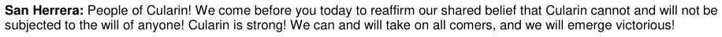
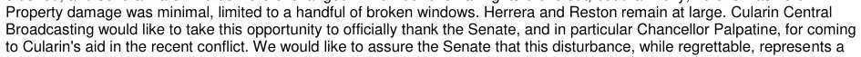

# Owner Material 037 — Star Wars D20 Drive folder (Core, Revised Core and Saga Edition): Living Force Campaign/Articles/Year 5/07:07:05 - All Comers.pdf [Star Wars Roleplaying Game Revised Core (d20, 2002)]

- **Source:** Wizards of the Coast Star Wars Roleplaying Game books, web enhancements, Living Force campaign modules and articles (2000–2010), from the owner's "Star Wars D20" Drive folder (only the three edition subfolders; "General" was not read, as instructed). Secondary source (licensed Legends reference). Scan OCR'd on the box; the scan stays box-only and is **not** published.
- **Method:** every scanned page was OCR'd and machine-screened sentence by sentence for power-relevant statements (fights, kills, defeats, Force feats, rankings, superweapons) that name a character on our roster; each kept sentence is quoted verbatim from the OCR text and has a crop of the printed passage directly under it. Pages with nothing power-relevant are still listed with what is on them.
- **Citation:** "*07:07:05 - All Comers* (SWRPG d20 Revised Core), p.X" by printed page ("scan p.X" where no printed number applies). **Weight:** Licensed RPG material: a secondary source. Narrative text sums up Legends lore; game statistics are rules for players, not canon power levels, and rank lowest.

## scan p.1 (scan page 1)

Page contents: Spoiler warning; framing; rally setup; San and Nia's 'All comers' speeches; crowd heckles (hand-read)

- **No single roster character (rules/setting/general)** — entry/section: San Herrera: "People of Cularin! We come before you today to reaffirm our shared belief that Cularin cannot and will not be subjected to the will of anyone! Cularin is strong! We can and will take on all comers, and we will emerge victorious!" Source: *07:07:05 - All Comers* (SWRPG d20 Revised Core), scan p.1
  

## scan p.2 (scan page 2)

Page contents: Calls to contact Senator Wren; Devaronian, Twi'lek and Wookiee speakers; San tries to calm the crowd (hand-read)

## scan p.3 (scan page 3)

Page contents: Gungan and his rifle Reva; celebratory blaster fire; drunk Tarasin speech; stage crushed; CCB thanks the Senate and Chancellor Palpatine (hand-read)

- **Palpatine (Darth Sidious)** — entry/section: Cularin Central Broadcasting voice-over: "Herrera and Reston remain at large. Cularin Central Broadcasting would like to take this opportunity to officially thank the Senate, and in particular Chancellor Palpatine, for coming to Cularin's aid in the recent conflict." Source: *07:07:05 - All Comers* (SWRPG d20 Revised Core), scan p.3
  
