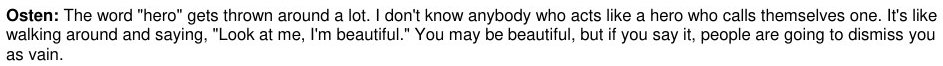
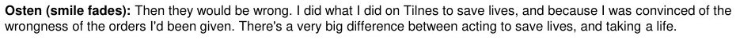
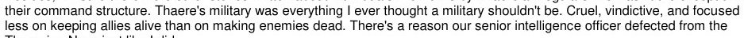
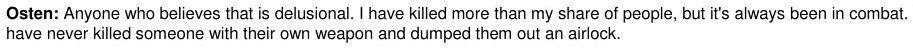

# Owner Material 037 — Star Wars D20 Drive folder (Core, Revised Core and Saga Edition): Living Force Campaign/Articles/Year 5/07:21:05 - Osten Dal'Nay.pdf [Star Wars Roleplaying Game Revised Core (d20, 2002)]

- **Source:** Wizards of the Coast Star Wars Roleplaying Game books, web enhancements, Living Force campaign modules and articles (2000–2010), from the owner's "Star Wars D20" Drive folder (only the three edition subfolders; "General" was not read, as instructed). Secondary source (licensed Legends reference). Scan OCR'd on the box; the scan stays box-only and is **not** published.
- **Method:** every scanned page was OCR'd and machine-screened sentence by sentence for power-relevant statements (fights, kills, defeats, Force feats, rankings, superweapons) that name a character on our roster; each kept sentence is quoted verbatim from the OCR text and has a crop of the printed passage directly under it. Pages with nothing power-relevant are still listed with what is on them.
- **Citation:** "*07:21:05 - Osten Dal'Nay* (SWRPG d20 Revised Core), p.X" by printed page ("scan p.X" where no printed number applies). **Weight:** Licensed RPG material: a secondary source. Narrative text sums up Legends lore; game statistics are rules for players, not canon power levels, and rank lowest.

## scan p.1 (scan page 1)

Page contents: Biography: Thaereian Navy service, Tilnes desertion, founding the Militia with Broof Yurdel; Chancellor Palpatine's disinterest in militias; Osten on heroism (hand-read)

- **No single roster character (rules/setting/general)** — entry/section: Osten Dal'Nay: "The word "hero" gets thrown around a lot. I don't know anybody who acts like a hero who calls themselves one. It's like walking around and saying, "Look at me, I'm beautiful." You may be beautiful, but if you say it, people are going to dismiss you as vain." Source: *07:21:05 - Osten Dal'Nay* (SWRPG d20 Revised Core), scan p.1
  

## scan p.2 (scan page 2)

Page contents: He admits writing 'The Best Defense'; Commander Kulkis; deserting vs. defecting; story as metaphor (hand-read)

- **No single roster character (rules/setting/general)** — entry/section: Osten Dal'Nay: "Then they would be wrong. I did what I did on Tilnes to save lives, and because I was convinced of the wrongness of the orders I'd been given. There's a very big difference between acting to save lives, and taking a life." Source: *07:21:05 - Osten Dal'Nay* (SWRPG d20 Revised Core), scan p.2
  
- **No single roster character (rules/setting/general)** — entry/section: Osten Dal'Nay: "Thaere's military was everything I ever thought a military shouldn't be. Cruel, vindictive, and focused less on keeping allies alive than on making enemies dead." Source: *07:21:05 - Osten Dal'Nay* (SWRPG d20 Revised Core), scan p.2
  

## scan p.3 (scan page 3)

Page contents: Denies killing Kulkis; Cloud Force and Sgt. Drover denied; transmission cut (hand-read)

- **No single roster character (rules/setting/general)** — entry/section: Osten Dal'Nay: "Anyone who believes that is delusional. I have killed more than my share of people, but it's always been in combat. I have never killed someone with their own weapon and dumped them out an airlock." Source: *07:21:05 - Osten Dal'Nay* (SWRPG d20 Revised Core), scan p.3
  
