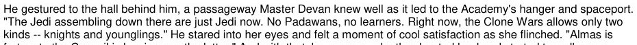
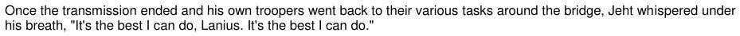

# Owner Material 037 — Star Wars D20 Drive folder (Core, Revised Core and Saga Edition): Living Force Campaign/Articles/Year 5/07:27:05 - 1 - Marching Orders.pdf [Star Wars Roleplaying Game Revised Core (d20, 2002)]

- **Source:** Wizards of the Coast Star Wars Roleplaying Game books, web enhancements, Living Force campaign modules and articles (2000–2010), from the owner's "Star Wars D20" Drive folder (only the three edition subfolders; "General" was not read, as instructed). Secondary source (licensed Legends reference). Scan OCR'd on the box; the scan stays box-only and is **not** published.
- **Method:** every scanned page was OCR'd and machine-screened sentence by sentence for power-relevant statements (fights, kills, defeats, Force feats, rankings, superweapons) that name a character on our roster; each kept sentence is quoted verbatim from the OCR text and has a crop of the printed passage directly under it. Pages with nothing power-relevant are still listed with what is on them.
- **Citation:** "*07:27:05 - 1 - Marching Orders* (SWRPG d20 Revised Core), p.X" by printed page ("scan p.X" where no printed number applies). **Weight:** Licensed RPG material: a secondary source. Narrative text sums up Legends lore; game statistics are rules for players, not canon power levels, and rank lowest.

## scan p.1 (scan page 1)

Page contents: Devan protests from her infirmary bed; Jeht in black armor; only knights and younglings; the 'Black Queen' slap; Lanius already told (hand-read)

- **No single roster character (rules/setting/general)** — entry/section: Darrus Jeht: "The Jedi assembling down there are just Jedi now. No Padawans, no learners. Right now, the Clone Wars allows only two kinds -- knights and younglings." Source: *07:27:05 - 1 - Marching Orders* (SWRPG d20 Revised Core), scan p.1
  

## scan p.2 (scan page 2)

Page contents: Right of Denial; the Maelstrom meets the clone cruisers Reliant and Devout; martial law under the EPA; Senator Wren investigated, Grand Chancellor backs her; shatterpoint; Almas kept off-limits (hand-read)

- **No single roster character (rules/setting/general)** — entry/section: Darrus Jeht: "It's the best I can do, Lanius. It's the best I can do." Source: *07:27:05 - 1 - Marching Orders* (SWRPG d20 Revised Core), scan p.2
  

## scan p.3 (scan page 3)

Page contents: Game notes: martial law; Option 1 Compliance; Option 2 Right of Denial with a mastercrafted lightsaber (hand-read)

