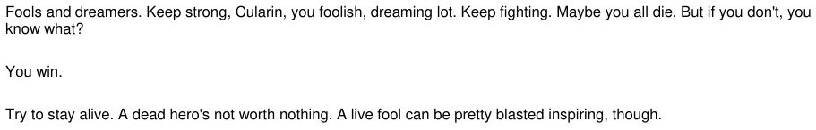

# Owner Material 037 — Star Wars D20 Drive folder (Core, Revised Core and Saga Edition): Living Force Campaign/Articles/Year 5/07:27:05 - 2 - A Hero's Death.pdf [Star Wars Roleplaying Game Revised Core (d20, 2002)]

- **Source:** Wizards of the Coast Star Wars Roleplaying Game books, web enhancements, Living Force campaign modules and articles (2000–2010), from the owner's "Star Wars D20" Drive folder (only the three edition subfolders; "General" was not read, as instructed). Secondary source (licensed Legends reference). Scan OCR'd on the box; the scan stays box-only and is **not** published.
- **Method:** every scanned page was OCR'd and machine-screened sentence by sentence for power-relevant statements (fights, kills, defeats, Force feats, rankings, superweapons) that name a character on our roster; each kept sentence is quoted verbatim from the OCR text and has a crop of the printed passage directly under it. Pages with nothing power-relevant are still listed with what is on them.
- **Citation:** "*07:27:05 - 2 - A Hero's Death* (SWRPG d20 Revised Core), p.X" by printed page ("scan p.X" where no printed number applies). **Weight:** Licensed RPG material: a secondary source. Narrative text sums up Legends lore; game statistics are rules for players, not canon power levels, and rank lowest.

## scan p.1 (scan page 1)

Page contents: Slicer's post: 'get out' of Cularin; mocks 'There is no death, there is the Force'; Jedi as ultimate soldiers; heroes end up dead (hand-read)

## scan p.2 (scan page 2)

Page contents: No such thing as a live hero; the galaxy lacks fools and dreamers; clones and droids; criticism of the Senate; 'Keep fighting... You win' (hand-read)

- **No single roster character (rules/setting/general)** — entry/section: Holonet slicer (post): "Fools and dreamers. Keep strong, Cularin, you foolish, dreaming lot. Keep fighting. Maybe you all die. But if you don't, you know what? You win. Try to stay alive. A dead hero's not worth nothing. A live fool can be pretty blasted inspiring, though." Source: *07:27:05 - 2 - A Hero's Death* (SWRPG d20 Revised Core), scan p.2
  
