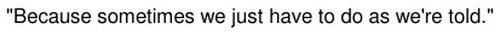

# Owner Material 037 — Star Wars D20 Drive folder (Core, Revised Core and Saga Edition): Living Force Campaign/Articles/Year 5/08:18:05 - Dark Hands.pdf [Star Wars Roleplaying Game Revised Core (d20, 2002)]

- **Source:** Wizards of the Coast Star Wars Roleplaying Game books, web enhancements, Living Force campaign modules and articles (2000–2010), from the owner's "Star Wars D20" Drive folder (only the three edition subfolders; "General" was not read, as instructed). Secondary source (licensed Legends reference). Scan OCR'd on the box; the scan stays box-only and is **not** published.
- **Method:** every scanned page was OCR'd and machine-screened sentence by sentence for power-relevant statements (fights, kills, defeats, Force feats, rankings, superweapons) that name a character on our roster; each kept sentence is quoted verbatim from the OCR text and has a crop of the printed passage directly under it. Pages with nothing power-relevant are still listed with what is on them.
- **Citation:** "*08:18:05 - Dark Hands* (SWRPG d20 Revised Core), p.X" by printed page ("scan p.X" where no printed number applies). **Weight:** Licensed RPG material: a secondary source. Narrative text sums up Legends lore; game statistics are rules for players, not canon power levels, and rank lowest.

## scan p.1 (scan page 1)

Page contents: Defector flees the Jedi through the droid factory; dwarf spider droids cut down; he uses dark-side concealment and dislikes non-Humans like his master (hand-read)

## scan p.2 (scan page 2)

Page contents: Grenade destroys the console; 'You are probably right'; Ventress rumor; telepathic voice; Jedi kills the defector from behind; game notes Holonet bonus (hand-read)

- **No single roster character (rules/setting/general)** — entry/section: Unnamed Jedi: "Because sometimes we just have to do as we're told." Source: *08:18:05 - Dark Hands* (SWRPG d20 Revised Core), scan p.2
  

### Stat block notes (game mechanics, not feats)

- Ventress's arena and attempt on Dooku (rumor): He'd heard that to prove her mettle, the Dark Jedi Ventress had sliced her way through an arena of gladiators and even tried to kill Dooku himself. (Source: *08:18:05 - Dark Hands* (SWRPG d20 Revised Core), scan p.2)
- Unnamed Jedi kills the defector: But halfway through his swing, a black-gloved hand drove the hilt of an unignited lightsaber into his chest. The searing pain of its violet blade erupting into life was the last thing he ever felt. His hands spasmed open and sent his own saber crashing to the floor. Dead before he fell, he missed the answer to his question. (Source: *08:18:05 - Dark Hands* (SWRPG d20 Revised Core), scan p.2)

## scan p.3 (scan page 3)

Page contents: (read from page image) Bonus can't be used for Knowledge (Sith Lore); Holonet carries no mention of the Sith (hand-read)

