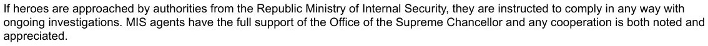

# Owner Material 037 — Star Wars D20 Drive folder (Core, Revised Core and Saga Edition): Living Force Campaign/Articles/Year 5/08:25:05 - Idiosyncrasies.pdf [Star Wars Roleplaying Game Revised Core (d20, 2002)]

- **Source:** Wizards of the Coast Star Wars Roleplaying Game books, web enhancements, Living Force campaign modules and articles (2000–2010), from the owner's "Star Wars D20" Drive folder (only the three edition subfolders; "General" was not read, as instructed). Secondary source (licensed Legends reference). Scan OCR'd on the box; the scan stays box-only and is **not** published.
- **Method:** every scanned page was OCR'd and machine-screened sentence by sentence for power-relevant statements (fights, kills, defeats, Force feats, rankings, superweapons) that name a character on our roster; each kept sentence is quoted verbatim from the OCR text and has a crop of the printed passage directly under it. Pages with nothing power-relevant are still listed with what is on them.
- **Citation:** "*08:25:05 - Idiosyncrasies* (SWRPG d20 Revised Core), p.X" by printed page ("scan p.X" where no printed number applies). **Weight:** Licensed RPG material: a secondary source. Narrative text sums up Legends lore; game statistics are rules for players, not canon power levels, and rank lowest.

## scan p.1 (scan page 1)

Page contents: Warlan Tosk vs. the clerk at the Republic safehouse; Senate seal; red uniforms of the Chancellor's guards; client Lavina Wren (hand-read)

## scan p.2 (scan page 2)

Page contents: Zabrak courier let in; Warlan reviews the earlier assassination attempts; recognizes the Zabrak; explosion; game notes: Wren presumed dead, MIS (hand-read)

- **Palpatine (Darth Sidious)** — entry/section: Living Force game notes: "If heroes are approached by authorities from the Republic Ministry of Internal Security, they are instructed to comply in any way with ongoing investigations. MIS agents have the full support of the Office of the Supreme Chancellor and any cooperation is both noted and appreciated." Source: *08:25:05 - Idiosyncrasies* (SWRPG d20 Revised Core), scan p.2
  
