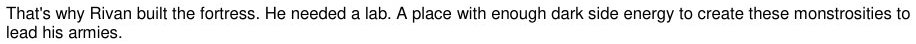

# Owner Material 037 — Star Wars D20 Drive folder (Core, Revised Core and Saga Edition): Living Force Campaign/Articles/Year 5/09:01:05 - 2 - Sith Battlelords.pdf [Star Wars Roleplaying Game Revised Core (d20, 2002)]

- **Source:** Wizards of the Coast Star Wars Roleplaying Game books, web enhancements, Living Force campaign modules and articles (2000–2010), from the owner's "Star Wars D20" Drive folder (only the three edition subfolders; "General" was not read, as instructed). Secondary source (licensed Legends reference). Scan OCR'd on the box; the scan stays box-only and is **not** published.
- **Method:** every scanned page was OCR'd and machine-screened sentence by sentence for power-relevant statements (fights, kills, defeats, Force feats, rankings, superweapons) that name a character on our roster; each kept sentence is quoted verbatim from the OCR text and has a crop of the printed passage directly under it. Pages with nothing power-relevant are still listed with what is on them.
- **Citation:** "*09:01:05 - 2 - Sith Battlelords* (SWRPG d20 Revised Core), p.X" by printed page ("scan p.X" where no printed number applies). **Weight:** Licensed RPG material: a secondary source. Narrative text sums up Legends lore; game statistics are rules for players, not canon power levels, and rank lowest.

## scan p.1 (scan page 1)

Page contents: Spoiler warning; leaked log; Almas fortress; Rivan's purpose; battlelords answer the problem behind the Rule of Two; blood ritual (hand-read)

## scan p.2 (scan page 2)

Page contents: 5 km tether, can't harm the battlelord, wounds transferred; GM section: Rivan perfected the process but was betrayed by his apprentice; ritual baseline; template stats (hand-read)

- **Darth Rivan** — entry/section: Anonymous holonet log: "That's why Rivan built the fortress. He needed a lab. A place with enough dark side energy to create these monstrosities to lead his armies." Source: *09:01:05 - 2 - Sith Battlelords* (SWRPG d20 Revised Core), scan p.2
  

### Stat block notes (game mechanics, not feats)

- Rivan perfected the battlelord process: Darth Rivan did perfect the process but was betrayed by his apprentice before being able to create sufficient battlelords to build an army. The process is painful and involved, and there is no guarantee that an individual who seeks to become a battlelord will actually survive the ritual. (Source: *09:01:05 - 2 - Sith Battlelords* (SWRPG d20 Revised Core), scan p.2)

## scan p.3 (scan page 3)

Page contents: Template feats and Charisma; Wounding, Painful, Quickening and Ferocious Bonds; Bonded template begins (hand-read)

## scan p.4 (scan page 4)

Page contents: Bonded Wounding and Painful Bond; breaking the bond with Force Light (hand-read)

