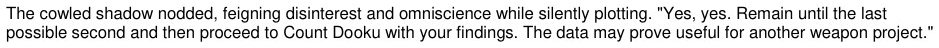
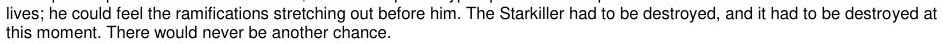
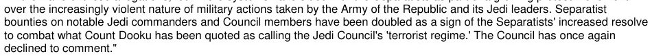

# Owner Material 037 — Star Wars D20 Drive folder (Core, Revised Core and Saga Edition): Living Force Campaign/Articles/Year 5/09:22:05 - Dark Soul.pdf [Star Wars Roleplaying Game Revised Core (d20, 2002)]

- **Source:** Wizards of the Coast Star Wars Roleplaying Game books, web enhancements, Living Force campaign modules and articles (2000–2010), from the owner's "Star Wars D20" Drive folder (only the three edition subfolders; "General" was not read, as instructed). Secondary source (licensed Legends reference). Scan OCR'd on the box; the scan stays box-only and is **not** published.
- **Method:** every scanned page was OCR'd and machine-screened sentence by sentence for power-relevant statements (fights, kills, defeats, Force feats, rankings, superweapons) that name a character on our roster; each kept sentence is quoted verbatim from the OCR text and has a crop of the printed passage directly under it. Pages with nothing power-relevant are still listed with what is on them.
- **Citation:** "*09:22:05 - Dark Soul* (SWRPG d20 Revised Core), p.X" by printed page ("scan p.X" where no printed number applies). **Weight:** Licensed RPG material: a secondary source. Narrative text sums up Legends lore; game statistics are rules for players, not canon power levels, and rank lowest.

## scan p.1 (scan page 1)

Page contents: Droid trap at Kromus; decoy gunship; 10% of the fleet lost; Maelstrom reaches orbit; Starkiller superweapon sighted (hand-read)

## scan p.2 (scan page 2)

Page contents: City of two million; planet holds 1.3 billion (Kromus/Kromol clerical error); weapon powers up; Jeht orders full bombardment; numbness; cowled lord's report; data to Count Dooku (hand-read)

- **Count Dooku** — entry/section: Cowled lord (unnamed): "Yes, yes. Remain until the last possible second and then proceed to Count Dooku with your findings. The data may prove useful for another weapon project." Source: *09:22:05 - Dark Soul* (SWRPG d20 Revised Core), scan p.2
  
- **Galen Marek**: "The Starkiller had to be destroyed, and it had to be destroyed at this moment." Source: *09:22:05 - Dark Soul* (SWRPG d20 Revised Core), scan p.2
  

### Stat block notes (game mechanics, not feats)

- General Darrus Jeht destroys the Starkiller: "Commander, open fire on the facility. Every gun, maximum power." For their part, the clones did not hesitate. The order was relayed and carried out within the space of a single second. General Jeht could feel the decks of the Maelstrom vibrate as volley after glowing volley tore through the atmosphere. The Starkiller, the research facility, and more than two million lives disappeared in a fireblossom of purifying light. The world itself shook, clouds of vapor and debris swirling for hundreds of miles around the impact site. (Source: *09:22:05 - Dark Soul* (SWRPG d20 Revised Core), scan p.2)

## scan p.3 (scan page 3)

Page contents: Crosstown Bar broadcast: Senate regret; 'scouring'; four systems defect; bounties doubled; Dooku's 'terrorist regime'; game notes (hand-read)

- **Count Dooku** — entry/section: Holonet war update: "Separatist bounties on notable Jedi commanders and Council members have been doubled as a sign of the Separatists' increased resolve to combat what Count Dooku has been quoted as calling the Jedi Council's 'terrorist regime.' The Council has once again declined to comment." Source: *09:22:05 - Dark Soul* (SWRPG d20 Revised Core), scan p.3
  
