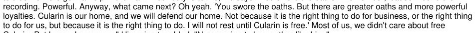

# Owner Material 037 — Star Wars D20 Drive folder (Core, Revised Core and Saga Edition): Living Force Campaign/Articles/Year 5/10:06:05 - Remember When.pdf [Star Wars Roleplaying Game Revised Core (d20, 2002)]

- **Source:** Wizards of the Coast Star Wars Roleplaying Game books, web enhancements, Living Force campaign modules and articles (2000–2010), from the owner's "Star Wars D20" Drive folder (only the three edition subfolders; "General" was not read, as instructed). Secondary source (licensed Legends reference). Scan OCR'd on the box; the scan stays box-only and is **not** published.
- **Method:** every scanned page was OCR'd and machine-screened sentence by sentence for power-relevant statements (fights, kills, defeats, Force feats, rankings, superweapons) that name a character on our roster; each kept sentence is quoted verbatim from the OCR text and has a crop of the printed passage directly under it. Pages with nothing power-relevant are still listed with what is on them.
- **Citation:** "*10:06:05 - Remember When* (SWRPG d20 Revised Core), p.X" by printed page ("scan p.X" where no printed number applies). **Weight:** Licensed RPG material: a secondary source. Narrative text sums up Legends lore; game statistics are rules for players, not canon power levels, and rank lowest.

## scan p.1 (scan page 1)

Page contents: Krakin's Alehouse and Sossk the Trandoshan bartender; trio remember Nirama punishing a commander who sold cargo to the Velkurs and the Twi'leks who harbored the Cell; 'cruel, but fair' (hand-read)

## scan p.2 (scan page 2)

Page contents: Fear that the loyalists will turn on each other; Nirama's 'Cularin is free' speech; he gave them identity; new boss is all business; blockade run (hand-read)

- **No single roster character (rules/setting/general)** — entry/section: Nirama (quoted by a former soldier): "You swore the oaths. But there are greater oaths and more powerful loyalties. Cularin is our home, and we will defend our home. Not because it is the right thing to do for business, or the right thing to do for us, but because it is the right thing to do. I will not rest until Cularin is free." Source: *10:06:05 - Remember When* (SWRPG d20 Revised Core), scan p.2
  
