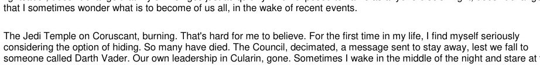
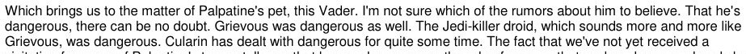
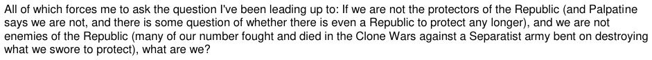
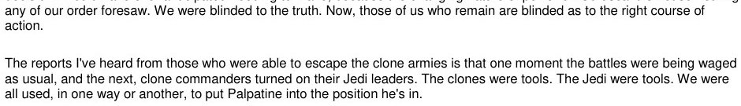

# Owner Material 037 — Star Wars D20 Drive folder (Core, Revised Core and Saga Edition): Living Force Campaign/Articles/Year 5/10:13:05 - What Are We, Then?.pdf [Star Wars Roleplaying Game Revised Core (d20, 2002)]

- **Source:** Wizards of the Coast Star Wars Roleplaying Game books, web enhancements, Living Force campaign modules and articles (2000–2010), from the owner's "Star Wars D20" Drive folder (only the three edition subfolders; "General" was not read, as instructed). Secondary source (licensed Legends reference). Scan OCR'd on the box; the scan stays box-only and is **not** published.
- **Method:** every scanned page was OCR'd and machine-screened sentence by sentence for power-relevant statements (fights, kills, defeats, Force feats, rankings, superweapons) that name a character on our roster; each kept sentence is quoted verbatim from the OCR text and has a crop of the printed passage directly under it. Pages with nothing power-relevant are still listed with what is on them.
- **Citation:** "*10:13:05 - What Are We, Then?* (SWRPG d20 Revised Core), p.X" by printed page ("scan p.X" where no printed number applies). **Weight:** Licensed RPG material: a secondary source. Narrative text sums up Legends lore; game statistics are rules for players, not canon power levels, and rank lowest.

## scan p.1 (scan page 1)

Page contents: Datapad framing; diaries vs. the holonet; Temple burning; warning about Darth Vader; Palpatine's Empire; 'what are we?'; rebels; Wren; Vader compared with Grievous and the Jedi-killer (hand-read)

- **Darth Vader (Anakin Skywalker); Palpatine (Darth Sidious)** — entry/section: Minos Fel'Kona: "The Jedi Temple on Coruscant, burning. That's hard for me to believe. For the first time in my life, I find myself seriously considering the option of hiding. So many have died. The Council, decimated, a message sent to stay away, lest we fall to someone called Darth Vader." Source: *10:13:05 - What Are We, Then?* (SWRPG d20 Revised Core), scan p.1
  
- **Darth Vader (Anakin Skywalker); Palpatine (Darth Sidious); General Grievous** — entry/section: Minos Fel'Kona: "Which brings us to the matter of Palpatine's pet, this Vader. I'm not sure which of the rumors about him to believe. That he's dangerous, there can be no doubt. Grievous was dangerous as well. The Jedi-killer droid, which sounds more and more like Grievous, was dangerous." Source: *10:13:05 - What Are We, Then?* (SWRPG d20 Revised Core), scan p.1
  
- **Palpatine (Darth Sidious)**: "All of which forces me to ask the question I've been leading up to: If we are not the protectors of the Republic (and Palpatine says we are not, and there is some question of whether there is even a Republic to protect any longer), and we are not enemies of the Republic (many of our number fought and died in the Clone Wars against a Separatist army bent on destroying what we swore to protect), what are we?" Source: *10:13:05 - What Are We, Then?* (SWRPG d20 Revised Core), scan p.1
  

## scan p.2 (scan page 2)

Page contents: Uncertainty; clones turned on their Jedi; Palpatine outmaneuvered the Masters; second-guessing his plans; decides to leave Cularin with every Jedi he can find (hand-read)

- **Palpatine (Darth Sidious)** — entry/section: Minos Fel'Kona: "The reports I've heard from those who were able to escape the clone armies is that one moment the battles were being waged as usual, and the next, clone commanders turned on their Jedi leaders. The clones were tools. The Jedi were tools. We were all used, in one way or another, to put Palpatine into the position he's in." Source: *10:13:05 - What Are We, Then?* (SWRPG d20 Revised Core), scan p.2
  

### Stat block notes (game mechanics, not feats)

- Palpatine outmaneuvered the Council: I do not now, nor will I ever, believe that the Jedi Council acted in any way contrary to the best interests of the galaxy. Which means that Palpatine did, and that he somehow managed to outmaneuver Masters Windu, Yoda, Tiin, Fisto, Kenobi and all the others who have been lost to us. (Source: *10:13:05 - What Are We, Then?* (SWRPG d20 Revised Core), scan p.2)
