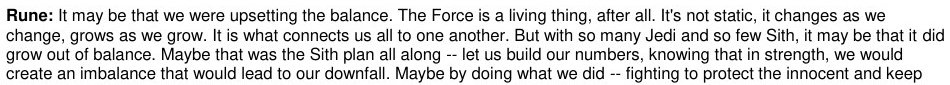

# Owner Material 037 — Star Wars D20 Drive folder (Core, Revised Core and Saga Edition): Living Force Campaign/Articles/Year 5/11:10:05 - In All Things Balance.pdf [Star Wars Roleplaying Game Revised Core (d20, 2002)]

- **Source:** Wizards of the Coast Star Wars Roleplaying Game books, web enhancements, Living Force campaign modules and articles (2000–2010), from the owner's "Star Wars D20" Drive folder (only the three edition subfolders; "General" was not read, as instructed). Secondary source (licensed Legends reference). Scan OCR'd on the box; the scan stays box-only and is **not** published.
- **Method:** every scanned page was OCR'd and machine-screened sentence by sentence for power-relevant statements (fights, kills, defeats, Force feats, rankings, superweapons) that name a character on our roster; each kept sentence is quoted verbatim from the OCR text and has a crop of the printed passage directly under it. Pages with nothing power-relevant are still listed with what is on them.
- **Citation:** "*11:10:05 - In All Things Balance* (SWRPG d20 Revised Core), p.X" by printed page ("scan p.X" where no printed number applies). **Weight:** Licensed RPG material: a secondary source. Narrative text sums up Legends lore; game statistics are rules for players, not canon power levels, and rank lowest.

## scan p.1 (scan page 1)

Page contents: Yara's sober intro; Nute and Rune masked; physics of balance; the prophecy; the Sith Rule of Two; would killing the Sith have caused an imbalance? (hand-read)

## scan p.2 (scan page 2)

Page contents: The dark side can't be wiped out; Sith plan theory; Yara's biography aside; Rune argues for learning the dark side; he grows frantic (hand-read)

- **No single roster character (rules/setting/general)** — entry/section: 'Rune' (masked Jedi): "It may be that we were upsetting the balance. The Force is a living thing, after all. It's not static, it changes as we change, grows as we grow. It is what connects us all to one another. But with so many Jedi and so few Sith, it may be that it did grow out of balance. Maybe that was the Sith plan all along -- let us build our numbers, knowing that in strength, we would create an imbalance that would lead to our downfall." Source: *11:10:05 - In All Things Balance* (SWRPG d20 Revised Core), scan p.2
  

## scan p.3 (scan page 3)

Page contents: (read from page image) Rune Force-chokes Nute: 'You want balance? I'll give you balance' (hand-read)

### Stat block notes (game mechanics, not feats)

- 'Rune' Force-chokes 'Nute': Rune's hand comes up, palm out, then balls into a fist. Nute gasps and sputters, hands flying to his throat. Air tries to rattle through his throat, fails, falls back into his lungs with a desperate gurgle. (Source: *11:10:05 - In All Things Balance* (SWRPG d20 Revised Core), scan p.3)
