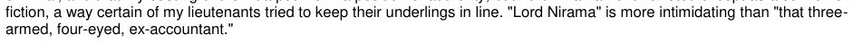
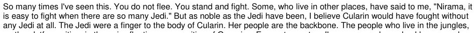

# Owner Material 037 — Star Wars D20 Drive folder (Core, Revised Core and Saga Edition): Living Force Campaign/Articles/Year 5/12:15:05 - Farewell.pdf [Star Wars Roleplaying Game Revised Core (d20, 2002)]

- **Source:** Wizards of the Coast Star Wars Roleplaying Game books, web enhancements, Living Force campaign modules and articles (2000–2010), from the owner's "Star Wars D20" Drive folder (only the three edition subfolders; "General" was not read, as instructed). Secondary source (licensed Legends reference). Scan OCR'd on the box; the scan stays box-only and is **not** published.
- **Method:** every scanned page was OCR'd and machine-screened sentence by sentence for power-relevant statements (fights, kills, defeats, Force feats, rankings, superweapons) that name a character on our roster; each kept sentence is quoted verbatim from the OCR text and has a crop of the printed passage directly under it. Pages with nothing power-relevant are still listed with what is on them.
- **Citation:** "*12:15:05 - Farewell* (SWRPG d20 Revised Core), p.X" by printed page ("scan p.X" where no printed number applies). **Weight:** Licensed RPG material: a secondary source. Narrative text sums up Legends lore; game statistics are rules for players, not canon power levels, and rank lowest.

## scan p.1 (scan page 1)

Page contents: Empire framing; Nirama's message; distrust of the Hutts; Nadin Paal; 'Lord Nirama' a fiction; his regret over the execution; the heroes changed him (hand-read)

- **No single roster character (rules/setting/general)** — entry/section: Nirama: ""Lord Nirama" is more intimidating than "that three-armed, four-eyed, ex-accountant."" Source: *12:15:05 - Farewell* (SWRPG d20 Revised Core), scan p.1
  

## scan p.2 (scan page 2)

Page contents: Why his ships defended Cularin; Oblee returned by the heroes' sacrifice; Jedi a finger, the people the backbone; thanks and farewell (hand-read)

- **No single roster character (rules/setting/general)** — entry/section: Nirama: "Some, who live in other places, have said to me, "Nirama, it is easy to fight when there are so many Jedi." But as noble as the Jedi have been, I believe Cularin would have fought without any Jedi at all. The Jedi were a finger to the body of Cularin. Her people are the backbone." Source: *12:15:05 - Farewell* (SWRPG d20 Revised Core), scan p.2
  
