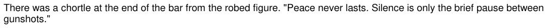
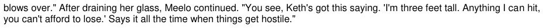

# Owner Material 037 — Star Wars D20 Drive folder (Core, Revised Core and Saga Edition): Living Force Campaign/Articles/Year 5/12:15:05 - Life According to Meelo.pdf [Star Wars Roleplaying Game Revised Core (d20, 2002)]

- **Source:** Wizards of the Coast Star Wars Roleplaying Game books, web enhancements, Living Force campaign modules and articles (2000–2010), from the owner's "Star Wars D20" Drive folder (only the three edition subfolders; "General" was not read, as instructed). Secondary source (licensed Legends reference). Scan OCR'd on the box; the scan stays box-only and is **not** published.
- **Method:** every scanned page was OCR'd and machine-screened sentence by sentence for power-relevant statements (fights, kills, defeats, Force feats, rankings, superweapons) that name a character on our roster; each kept sentence is quoted verbatim from the OCR text and has a crop of the printed passage directly under it. Pages with nothing power-relevant are still listed with what is on them.
- **Citation:** "*12:15:05 - Life According to Meelo* (SWRPG d20 Revised Core), p.X" by printed page ("scan p.X" where no printed number applies). **Weight:** Licensed RPG material: a secondary source. Narrative text sums up Legends lore; game statistics are rules for players, not canon power levels, and rank lowest.

## scan p.1 (scan page 1)

Page contents: Crosstown framing; Meelo losing at sabacc; the WOLF origin story begins; failed subtle approach at the Cartel building (hand-read)

## scan p.2 (scan page 2)

Page contents: Keth-Keth's plan; Roorrrwiir can't drive; crash into the Cartel building; rescue; OPS speeder stun-grenaded; 'W.O.L.F.' graffiti; now a real organization (hand-read)

- **No single roster character (rules/setting/general)** — entry/section: Hooded man at the bar: "Peace never lasts. Silence is only the brief pause between gunshots." Source: *12:15:05 - Life According to Meelo* (SWRPG d20 Revised Core), scan p.2
  

## scan p.3 (scan page 3)

Page contents: Keth's 'three feet tall' saying; the clone ID check and the stun glove; game notes: Jawa vocoder (hand-read)

- **No single roster character (rules/setting/general)** — entry/section: Keth-Keth (quoted by Meelo): "I'm three feet tall. Anything I can hit, you can't afford to lose." Source: *12:15:05 - Life According to Meelo* (SWRPG d20 Revised Core), scan p.3
  
