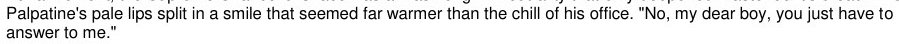
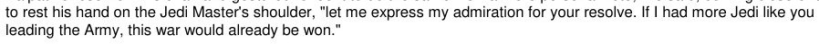
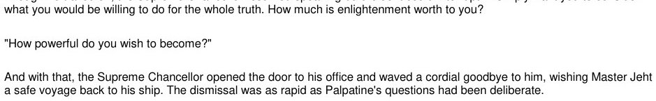
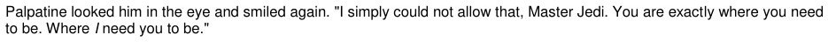
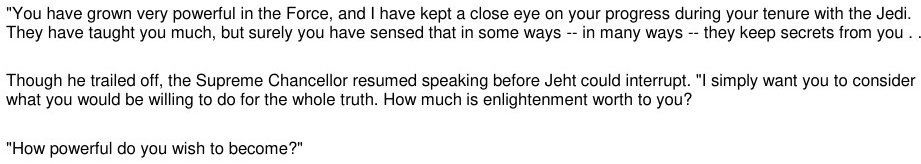

# Owner Material 037 — Star Wars D20 Drive folder (Core, Revised Core and Saga Edition): Living Force Campaign/Articles/Year 6/01:19:06 - 2 - Dark Hope.pdf [Star Wars Roleplaying Game Revised Core (d20, 2002)]

- **Source:** Wizards of the Coast Star Wars Roleplaying Game books, web enhancements, Living Force campaign modules and articles (2000–2010), from the owner's "Star Wars D20" Drive folder (only the three edition subfolders; "General" was not read, as instructed). Secondary source (licensed Legends reference). Scan OCR'd on the box; the scan stays box-only and is **not** published.
- **Method:** every scanned page was OCR'd and machine-screened sentence by sentence for power-relevant statements (fights, kills, defeats, Force feats, rankings, superweapons) that name a character on our roster; each kept sentence is quoted verbatim from the OCR text and has a crop of the printed passage directly under it. Pages with nothing power-relevant are still listed with what is on them.
- **Citation:** "*01:19:06 - 2 - Dark Hope* (SWRPG d20 Revised Core), p.X" by printed page ("scan p.X" where no printed number applies). **Weight:** Licensed RPG material: a secondary source. Narrative text sums up Legends lore; game statistics are rules for players, not canon power levels, and rank lowest.

## scan p.1 (scan page 1)

Page contents: Palpatine's cold office; Jeht summoned over Kromus; no Senate inquiry: 'you just have to answer to me' (hand-read)

- **Palpatine (Darth Sidious)** — entry/section: Supreme Chancellor Palpatine to Darrus Jeht: "No, my dear boy, you just have to answer to me." Source: *01:19:06 - 2 - Dark Hope* (SWRPG d20 Revised Core), scan p.1
  

## scan p.2 (scan page 2)

Page contents: 'Did you do what was necessary?'; Starkiller superweapon; Jeht stands by his choice; exonerated; Palpatine's praise (hand-read)

- **Palpatine (Darth Sidious)** — entry/section: Supreme Chancellor Palpatine to Darrus Jeht: "On a more personal note, let me express my admiration for your resolve. If I had more Jedi like you leading the Army, this war would already be won." Source: *01:19:06 - 2 - Dark Hope* (SWRPG d20 Revised Core), scan p.2
  

## scan p.3 (scan page 3)

Page contents: 'Where I need you to be'; secrets the Jedi keep; 'How powerful do you wish to become?'; Jeht heads for Almas; Windu's secret meeting; game notes (hand-read)

- **Palpatine (Darth Sidious)** — entry/section: 01:19:06 - 2 - Dark Hope: ""How powerful do you wish to become?" And with that, the Supreme Chancellor opened the door to his office and waved a cordial goodbye to him, wishing Master Jeht a safe voyage back to his ship." Source: *01:19:06 - 2 - Dark Hope* (SWRPG d20 Revised Core), scan p.3
  
- **Palpatine (Darth Sidious)** — entry/section: Supreme Chancellor Palpatine to Darrus Jeht: "I simply could not allow that, Master Jedi. You are exactly where you need to be. Where I need you to be." Source: *01:19:06 - 2 - Dark Hope* (SWRPG d20 Revised Core), scan p.3
  
- **Palpatine (Darth Sidious)** — entry/section: Supreme Chancellor Palpatine to Darrus Jeht: "You have grown very powerful in the Force, and I have kept a close eye on your progress during your tenure with the Jedi. They have taught you much, but surely you have sensed that in some ways -- in many ways -- they keep secrets from you . . . I simply want you to consider what you would be willing to do for the whole truth. How much is enlightenment worth to you? How powerful do you wish to become?" Source: *01:19:06 - 2 - Dark Hope* (SWRPG d20 Revised Core), scan p.3
  
