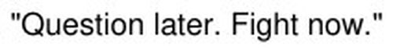

# Owner Material 037 — Star Wars D20 Drive folder (Core, Revised Core and Saga Edition): Living Force Campaign/Articles/Year 6/02:02:06 - Faded Colors.pdf [Star Wars Roleplaying Game Revised Core (d20, 2002)]

- **Source:** Wizards of the Coast Star Wars Roleplaying Game books, web enhancements, Living Force campaign modules and articles (2000–2010), from the owner's "Star Wars D20" Drive folder (only the three edition subfolders; "General" was not read, as instructed). Secondary source (licensed Legends reference). Scan OCR'd on the box; the scan stays box-only and is **not** published.
- **Method:** every scanned page was OCR'd and machine-screened sentence by sentence for power-relevant statements (fights, kills, defeats, Force feats, rankings, superweapons) that name a character on our roster; each kept sentence is quoted verbatim from the OCR text and has a crop of the printed passage directly under it. Pages with nothing power-relevant are still listed with what is on them.
- **Citation:** "*02:02:06 - Faded Colors* (SWRPG d20 Revised Core), p.X" by printed page ("scan p.X" where no printed number applies). **Weight:** Licensed RPG material: a secondary source. Narrative text sums up Legends lore; game statistics are rules for players, not canon power levels, and rank lowest.

## scan p.1 (scan page 1)

Page contents: Barnab's training under the Master in Violet; smoke; the gutted Training Hall; drained bodies; the Masters in Green and Red dead (hand-read)

## scan p.2 (scan page 2)

Page contents: The Master in White dead; the Violet Gallery; songsteel staff vs. the shadow's black staff; rocket gun; the shadow escapes, trees wither (hand-read)

### Stat block notes (game mechanics, not feats)

- Shadow figure's draining assault: Her foe was impossible to see clearly. Surrounded by shifting, impossibly deep shadows, it held aloft a similar weapon. Similar, but not at all the same once Barnab got a closer look at it. The staff it was swinging with devastating skill and speed was utterly black and difficult to look at. Every sense he had and several he'd never felt before screamed at him that the weapon was utterly wrong. (Source: *02:02:06 - Faded Colors* (SWRPG d20 Revised Core), scan p.2)

## scan p.3 (scan page 3)

Page contents: The dead students rise: 'Question later. Fight now.'; game notes: Temple destroyed, Chistor missing (hand-read)

- **No single roster character (rules/setting/general)** — entry/section: Master in Violet: "Question later. Fight now." Source: *02:02:06 - Faded Colors* (SWRPG d20 Revised Core), scan p.3
  
