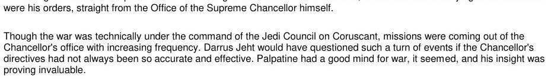
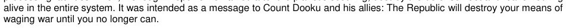
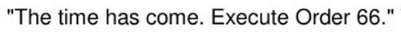

# Owner Material 037 — Star Wars D20 Drive folder (Core, Revised Core and Saga Edition): Living Force Campaign/Articles/Year 6/02:16:06 - Living Force - Dark Shadows.pdf [Star Wars Roleplaying Game Revised Core (d20, 2002)]

- **Source:** Wizards of the Coast Star Wars Roleplaying Game books, web enhancements, Living Force campaign modules and articles (2000–2010), from the owner's "Star Wars D20" Drive folder (only the three edition subfolders; "General" was not read, as instructed). Secondary source (licensed Legends reference). Scan OCR'd on the box; the scan stays box-only and is **not** published.
- **Method:** every scanned page was OCR'd and machine-screened sentence by sentence for power-relevant statements (fights, kills, defeats, Force feats, rankings, superweapons) that name a character on our roster; each kept sentence is quoted verbatim from the OCR text and has a crop of the printed passage directly under it. Pages with nothing power-relevant are still listed with what is on them.
- **Citation:** "*02:16:06 - Living Force - Dark Shadows* (SWRPG d20 Revised Core), p.X" by printed page ("scan p.X" where no printed number applies). **Weight:** Licensed RPG material: a secondary source. Narrative text sums up Legends lore; game statistics are rules for players, not canon power levels, and rank lowest.

## scan p.1 (scan page 1)

Page contents: Corlax 4 orders from the Chancellor's office; message to Count Dooku; Jeht's guilt and nightmares over Kromol; 'Untaire' coded transmission (hand-read)

- **Palpatine (Darth Sidious)** — entry/section: Narration (Palpatine's war orders): "Though the war was technically under the command of the Jedi Council on Coruscant, missions were coming out of the Chancellor's office with increasing frequency. Darrus Jeht would have questioned such a turn of events if the Chancellor's directives had not always been so accurate and effective. Palpatine had a good mind for war, it seemed, and his insight was proving invaluable." Source: *02:16:06 - Living Force - Dark Shadows* (SWRPG d20 Revised Core), scan p.1
  
- **Count Dooku**: "It was intended as a message to Count Dooku and his allies: The Republic will destroy your means of waging war until you no longer can." Source: *02:16:06 - Living Force - Dark Shadows* (SWRPG d20 Revised Core), scan p.1
  

## scan p.2 (scan page 2)

Page contents: Milinae, not Trilinae; Cularin independent; Tril's ship attacked; bodyguards and shuttle 'missing' but tracked; trouble on Cularin (hand-read)

## scan p.3 (scan page 3)

Page contents: Almas destroyed; Jeht disobeys and heads for Cularin; Order 66 to Mar'ek; game notes: availability checks (hand-read)

- **No single roster character (rules/setting/general)** — entry/section: Hooded figure (hologram): "The time has come. Execute Order 66." Source: *02:16:06 - Living Force - Dark Shadows* (SWRPG d20 Revised Core), scan p.3
  
