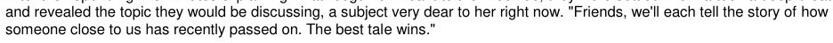
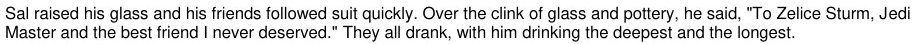

# Owner Material 037 — Star Wars D20 Drive folder (Core, Revised Core and Saga Edition): Living Force Campaign/Articles/Year 6/02:23:06 - Living Force - From the Cradle to the Grave.pdf [Star Wars Roleplaying Game Revised Core (d20, 2002)]

- **Source:** Wizards of the Coast Star Wars Roleplaying Game books, web enhancements, Living Force campaign modules and articles (2000–2010), from the owner's "Star Wars D20" Drive folder (only the three edition subfolders; "General" was not read, as instructed). Secondary source (licensed Legends reference). Scan OCR'd on the box; the scan stays box-only and is **not** published.
- **Method:** every scanned page was OCR'd and machine-screened sentence by sentence for power-relevant statements (fights, kills, defeats, Force feats, rankings, superweapons) that name a character on our roster; each kept sentence is quoted verbatim from the OCR text and has a crop of the printed passage directly under it. Pages with nothing power-relevant are still listed with what is on them.
- **Citation:** "*02:23:06 - Living Force - From the Cradle to the Grave* (SWRPG d20 Revised Core), p.X" by printed page ("scan p.X" where no printed number applies). **Weight:** Licensed RPG material: a secondary source. Narrative text sums up Legends lore; game statistics are rules for players, not canon power levels, and rank lowest.

## scan p.1 (scan page 1)

Page contents: Kaavo cut in tenths; arm-wrestling refused; 'trial by elocution'; Renna names the topic (hand-read)

- **No single roster character (rules/setting/general)** — entry/section: Renna: "Friends, we'll each tell the story of how someone close to us has recently passed on. The best tale wins." Source: *02:23:06 - Living Force - From the Cradle to the Grave* (SWRPG d20 Revised Core), scan p.1
  

## scan p.2 (scan page 2)

Page contents: Renna's tale of Teelo, killed by Riboga's goons; Sal's tale begins: the Black Queen (hand-read)

## scan p.3 (scan page 3)

Page contents: Zelice Sturm redeemed and dies on Almas; toast; Ooorlak's tale of Kirlocca's last stand (hand-read)

- **No single roster character (rules/setting/general)** — entry/section: Sal: "To Zelice Sturm, Jedi Master and the best friend I never deserved." Source: *02:23:06 - Living Force - From the Cradle to the Grave* (SWRPG d20 Revised Core), scan p.3
  

### Stat block notes (game mechanics, not feats)

- Kirlocca's last stand (as told by Ooorlak): Betrayed from behind by a false Jedi he'd been protecting, Kirlocca remained proud and strong as he bought time for the delegates and the other heroes aiding them with his own life. The Jedi Master fell in battle, but he did so with honor, steadfast to the very end. (Source: *02:23:06 - Living Force - From the Cradle to the Grave* (SWRPG d20 Revised Core), scan p.3)

## scan p.4 (scan page 4)

Page contents: No winner; the kaavo goes to the Wall of Remembrance; 'They aren't really gone, are they?' (hand-read)

