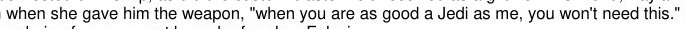

# Owner Material 037 — Star Wars D20 Drive folder (Core, Revised Core and Saga Edition): Living Force Campaign/Articles/Year 6/03:02:06 - Living Force - One Minute to Midnight.pdf [Star Wars Roleplaying Game Revised Core (d20, 2002)]

- **Source:** Wizards of the Coast Star Wars Roleplaying Game books, web enhancements, Living Force campaign modules and articles (2000–2010), from the owner's "Star Wars D20" Drive folder (only the three edition subfolders; "General" was not read, as instructed). Secondary source (licensed Legends reference). Scan OCR'd on the box; the scan stays box-only and is **not** published.
- **Method:** every scanned page was OCR'd and machine-screened sentence by sentence for power-relevant statements (fights, kills, defeats, Force feats, rankings, superweapons) that name a character on our roster; each kept sentence is quoted verbatim from the OCR text and has a crop of the printed passage directly under it. Pages with nothing power-relevant are still listed with what is on them.
- **Citation:** "*03:02:06 - Living Force - One Minute to Midnight* (SWRPG d20 Revised Core), p.X" by printed page ("scan p.X" where no printed number applies). **Weight:** Licensed RPG material: a secondary source. Narrative text sums up Legends lore; game statistics are rules for players, not canon power levels, and rank lowest.

## scan p.1 (scan page 1)

Page contents: Darrus prepares to greet his guard; Aayla's gift blaster; the clones will follow orders; course for Cularin; distant capital ship contact (hand-read)

- **Aayla Secura** — entry/section: Aayla Secura (recalled by Darrus Jeht): "Someday, when you are as good a Jedi as me, you won't need this." Source: *03:02:06 - Living Force - One Minute to Midnight* (SWRPG d20 Revised Core), scan p.1
  

## scan p.2 (scan page 2)

Page contents: Priority One from the Council Hall; astromech kills comms; he feels Aayla die on Felucia; lift ambush; he kills the squad (hand-read)

### Stat block notes (game mechanics, not feats)

- Aayla Secura's death felt through the Force: It was Felucia. It was Aayla! He could feel her pain; he was feeling her die! "No!" he screamed into the confines of the lift car, with no one to hear his grief. He desperately clung to the last moments of her mind, her fading life, as a drowning man would clutch at burning driftwood. In her last heartbeat, Darrus saw white-booted feet and the blaze of blasters. He saw, in that final second, his sweet friend's killers. (Source: *03:02:06 - Living Force - One Minute to Midnight* (SWRPG d20 Revised Core), scan p.2)
- Darrus Jeht's lift ambush: A second later, his helmet exploded forward in a shower of purple radiance as a lightsaber arced through it from above. Darrus dropped from his position against the roof of the lift and fell in a crouch behind the now-headless trooper. Mar'ek shouted for his squad to open fire, but the dead clone's body absorbed the wave of incoming bolts. (Source: *03:02:06 - Living Force - One Minute to Midnight* (SWRPG d20 Revised Core), scan p.2)

## scan p.3 (scan page 3)

Page contents: Thrown lightsaber takes Mar'ek's hands; 'Where is she?'; Mar'ek's lie; Jeht kills him and spaces the bodies; game notes (hand-read)

### Stat block notes (game mechanics, not feats)

- Darrus Jeht's thrown lightsaber: A glowing curve of violet, the lightsaber flew through the air and collided with the ARC Trooper's guns. There was a dual spray of molten metal and the searing agony of an energy blade ablating away both his hands. Then, as Mar'ek collapsed in shock, he saw the burning sword reverse direction and fly back to its master's waiting grasp. (Source: *03:02:06 - Living Force - One Minute to Midnight* (SWRPG d20 Revised Core), scan p.3)
