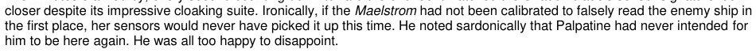

# Owner Material 037 — Star Wars D20 Drive folder (Core, Revised Core and Saga Edition): Living Force Campaign/Articles/Year 7/02:01:07 - Living Force - Last Stand.pdf [Star Wars Roleplaying Game Revised Core (d20, 2002)]

- **Source:** Wizards of the Coast Star Wars Roleplaying Game books, web enhancements, Living Force campaign modules and articles (2000–2010), from the owner's "Star Wars D20" Drive folder (only the three edition subfolders; "General" was not read, as instructed). Secondary source (licensed Legends reference). Scan OCR'd on the box; the scan stays box-only and is **not** published.
- **Method:** every scanned page was OCR'd and machine-screened sentence by sentence for power-relevant statements (fights, kills, defeats, Force feats, rankings, superweapons) that name a character on our roster; each kept sentence is quoted verbatim from the OCR text and has a crop of the printed passage directly under it. Pages with nothing power-relevant are still listed with what is on them.
- **Citation:** "*02:01:07 - Living Force - Last Stand* (SWRPG d20 Revised Core), p.X" by printed page ("scan p.X" where no printed number applies). **Weight:** Licensed RPG material: a secondary source. Narrative text sums up Legends lore; game statistics are rules for players, not canon power levels, and rank lowest.

## scan p.1 (scan page 1)

Page contents: Jedi refugee ships gunned down; deception of the Undaunted and Primal; surprise broadside; fighters scrambled; R-0's false signals (hand-read)

## scan p.2 (scan page 2)

Page contents: Clones conclude battle-droid pilots; comms locked out; Undaunted destroyed; bow-thruster flip (hand-read)

### Stat block notes (game mechanics, not feats)

- Darrus Jeht's bow-thruster flip: Intended for slowing duties when the Maelstrom made its infrequent landings, the bow thrusters were never designed to be used in space. The effect of doing so was not something the crew could have anticipated, but it was exactly what Jeht had counted on -- the vessel flipped over while still moving forward at a crawl. (Source: *02:01:07 - Living Force - Last Stand* (SWRPG d20 Revised Core), scan p.2)

## scan p.3 (scan page 3)

Page contents: Primal destroyed; self-destruct plan; the Shadowblade appears, its destruction a lie; heading for Cularin (hand-read)

## scan p.4 (scan page 4)

Page contents: Ramming course; 'Palpatine had never intended for him to be here again'; Nirama's hidden lanes; ten years lost to the Darkstaff; R-0 sent away; time rift; dumb-fire torpedoes (hand-read)

- **Palpatine (Darth Sidious)** — entry/section: Narration (Darrus Jeht): "Ironically, if the Maelstrom had not been calibrated to falsely read the enemy ship in the first place, her sensors would never have picked it up this time. He noted sardonically that Palpatine had never intended for him to be here again. He was all too happy to disappoint." Source: *02:01:07 - Living Force - Last Stand* (SWRPG d20 Revised Core), scan p.4
  

## scan p.5 (scan page 5)

Page contents: The Shadowblade turns; scan for the rift's eye; cloak weak when firing; tractor beam; '.03 degrees starboard' (hand-read)

### Stat block notes (game mechanics, not feats)

- Darrus Jeht's tractor-beam gambit: The dorsal array near the nose of the Maelstrom spun around, grinding on half-damaged actuators to do so. It opened up with a scintillating gray beam nearly invisible to the eye but very noticeable in its effect. The Shadowblade jerked momentarily out of control, caught in an overcharged tractor beam so powerful that it could not immediately break free. (Source: *02:01:07 - Living Force - Last Stand* (SWRPG d20 Revised Core), scan p.5)

## scan p.6 (scan page 6)

Page contents: Both ships plunge into the rift; game notes: campaign ends December 31, 2006 (hand-read)

