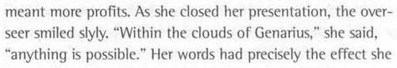
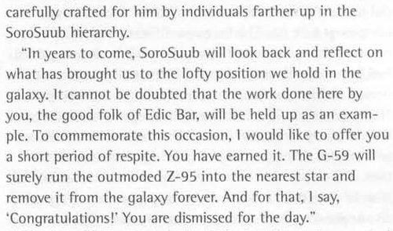
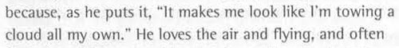
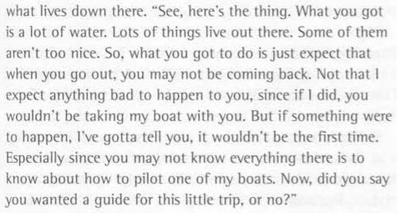
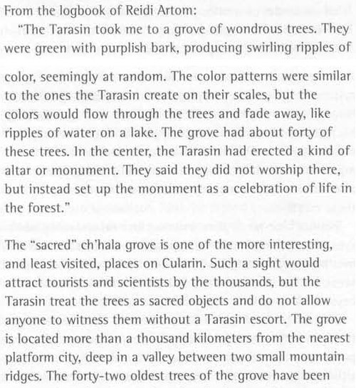
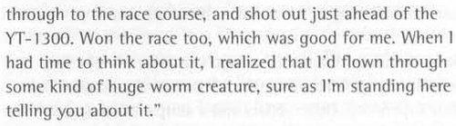
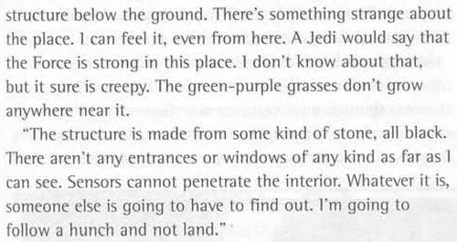
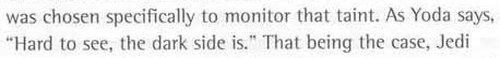
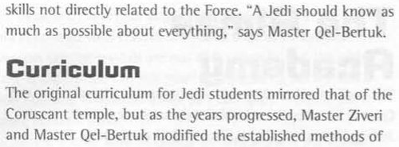

# Owner Material 037 — Star Wars D20 Drive folder (Core, Revised Core and Saga Edition): Living Force Campaign/Campaign Guide/Living Force Campaign Guide.pdf [Star Wars Roleplaying Game Revised Core (d20, 2002)] (scan pages 1–60)

- **Source:** Wizards of the Coast Star Wars Roleplaying Game books, web enhancements, Living Force campaign modules and articles (2000–2010), from the owner's "Star Wars D20" Drive folder (only the three edition subfolders; "General" was not read, as instructed). Secondary source (licensed Legends reference). Scan OCR'd on the box; the scan stays box-only and is **not** published.
- **Method:** every scanned page was OCR'd and machine-screened sentence by sentence for power-relevant statements (fights, kills, defeats, Force feats, rankings, superweapons) that name a character on our roster; each kept sentence is quoted verbatim from the OCR text and has a crop of the printed passage directly under it. Pages with nothing power-relevant are still listed with what is on them.
- **Citation:** "*Living Force Campaign Guide* (SWRPG d20 Revised Core), p.X" by printed page ("scan p.X" where no printed number applies). **Weight:** Licensed RPG material: a secondary source. Narrative text sums up Legends lore; game statistics are rules for players, not canon power levels, and rank lowest.

## scan p.1 (scan page 1)

Page contents: Cover (hand-read)

## scan p.2 (scan page 2)

Page contents: Credits; contents (hand-read)

## scan p.3 (scan page 3)

Page contents: Introduction with Lanius Qel-Bertuk's opening monologue (hand-read)

## scan p.4 (scan page 4)

Page contents: Cularin System Overview: formation; man in black (Sith) terraforms 4th planet; Age of Discovery; timeline; Reidi Artom discovery (hand-read)

### Stat block notes (game mechanics, not feats)

- Unnamed Sith terraforms the fourth planet (man dressed in black; identified as Darth Rivan on p38): A man dressed in black steps off a transport. He builds a refuge for himself on the fourth planet, just outside the asteroid belt, where he can delve into the mysteries of the dark side. By creating a form of plant life, he converts the poisonous atmosphere of his chosen world into breathable gas. ... The figure in black is eventually hunted and forced from the system during the Sith Wars, leaving behind his ecological creation and a grim fortress half buried in the ground. (Source: *Living Force Campaign Guide* (SWRPG d20 Revised Core), scan p.4)

## scan p.5 (scan page 5)

Page contents: Reidi Artom sidebar and stats; settlement; The Coming of the Jedi; Kibh Jeen and Qornah (hand-read)

### Stat block notes (game mechanics, not feats)

- Kibh Jeen falls (Kibh Jeen): Kibh Jeen succumbs to whispered temptations, cutting his master down from behind. Stepping over the body, he approaches the walls of the fortress and disappears. (Source: *Living Force Campaign Guide* (SWRPG d20 Revised Core), scan p.5)

## scan p.6 (scan page 6)

Page contents: Kibh Jeen's fall and the Dark Jedi Conflict; Academy founded; Nerra Ziveri disappears, Lanius takes over (hand-read)

### Stat block notes (game mechanics, not feats)

- Kibh Jeen's assault on Genarius (Kibh Jeen): In an almost thoughtless display of power, he dominates their minds, and through them, attracts others to his service. An army grows. After his servants sabotage a local power plant, he unleashes his anger at the floating cities of Genarius. Lightning arcs through the great clouds, destroying hundreds of homes as his followers scream through the streets, blasters white-hot. Thousands die. (Source: *Living Force Campaign Guide* (SWRPG d20 Revised Core), scan p.6)

## scan p.7 (scan page 7)

Page contents: Tarasin Revolt; Cularin Compact; Rise in Crime (Riboga loses operation to Nirama at sabacc); Trade Wars (hand-read)

## scan p.8 (scan page 8)

Page contents: Trade Federation withdraws; Cularin Today (Republic membership, Colonel Jir Tramsig, secret base on Ostfrei, rumored Dark Jedi); System Catalog; Acilaris begins (hand-read)

## scan p.9 (scan page 9)

Page contents: System map (image) (hand-read)

## scan p.10 (scan page 10)

Page contents: System map labels (hand-read)

## scan p.11 (scan page 11)

Page contents: Acilaris; Cularin planet; kilassin, mulissiki; Tarasin natives (hand-read)

## scan p.12 (scan page 12)

Page contents: Tarasin species traits; kilassin and mulissik stats (hand-read)

## scan p.13 (scan page 13)

Page contents: Tarasin culture; Irstat-Kes and Mothers; Hiironi and Cloud Mountain (hand-read)

## scan p.14 (scan page 14)

Page contents: Dariana, Cryalira, Fissona (hand-read)

## scan p.15 (scan page 15)

Page contents: Fissona stats; Gadrin and Hedrett (hand-read)

## scan p.16 (scan page 16)

Page contents: Governance; Westa Impeveri election; Reidi Artom museum; Barnab Chistor (hand-read)

## scan p.17 (scan page 17)

Page contents: Westa Impeveri; Kim Klib; platform cities (hand-read)

## scan p.18 (scan page 18)

Page contents: Baron administrators; police; mulissiki problem; Mikish (Nirama), Tindark, Bollin; Hlisk Squin (hand-read)

## scan p.19 (scan page 19)

Page contents: Hlisk Squin; Dirneele; Kyun Squnn; Soboll military base and Nirama's mole (hand-read)

## scan p.20 (scan page 20)

Page contents: Major Kurth San; Rennokk (hand-read)

## scan p.21 (scan page 21)

Page contents: Rennokk lava creature (Tusskrek); Tilnes crystal mines; VMMC (hand-read)

## scan p.22 (scan page 22)

Page contents: VMMC politics, snub by Riboga; Hiem Bryl (hand-read)

## scan p.23 (scan page 23)

Page contents: Maris Gen; S-4QD; Genarius; Nub Saar disaster (hand-read)

## scan p.24 (scan page 24)

Page contents: Radiation shields; Friz Harammel overseer quote; Central Council politics (hand-read)

- **No single roster character (rules/setting/general)** — entry/section: Friz Harammel overseer (unnamed overseer): ""Within the clouds of Genarius," she said, "anything is possible."" Source: *Living Force Campaign Guide* (SWRPG d20 Revised Core), scan p.24
  

## scan p.25 (scan page 25)

Page contents: Riboga's Council; cochlera, "Jedi Mind Juice"; industries; SoroSuub (hand-read)

## scan p.26 (scan page 26)

Page contents: Edic Bar; G-59 Cannibalizer; Miim Te'Suub speech and the origin of Festival (hand-read)

- **No single roster character (rules/setting/general)** — entry/section: Miim Te'Suub's speech (Miim Te'Suub): ""In years to come, SoroSuub will look back and reflect on what has brought us to the lofty position we hold in the galaxy. It cannot be doubted that the work done here by you, the good folk of Edic Bar, will be held up as an example. To commemorate this occasion, I would like to offer you a short period of respite. You have earned it. The G-59 will surely run the outmoded Z-95 into the nearest star and remove it from the galaxy forever. And for that, I say, 'Congratulations!' You are dismissed for the day."" Source: *Living Force Campaign Guide* (SWRPG d20 Revised Core), scan p.26
  

## scan p.27 (scan page 27)

Page contents: Miim Te'Suub; Juuus; IT-09 (hand-read)

## scan p.28 (scan page 28)

Page contents: Friz Harammel and DGM; Erd Lumas; Tchaw Fenn (hand-read)

- **No single roster character (rules/setting/general)** — entry/section: Erd Lumas on the Bubblecraft (Erd Lumas): ""It makes me look like I'm towing a cloud all my own."" Source: *Living Force Campaign Guide* (SWRPG d20 Revised Core), scan p.28
  

## scan p.29 (scan page 29)

Page contents: Tchaw Fenn stats; Hid Toqema; Ipsus/Naescorcom; Loa Tibeeme (hand-read)

## scan p.30 (scan page 30)

Page contents: Loa Tibeeme; Nui Gneppe; Tolea Biqua (hand-read)

## scan p.31 (scan page 31)

Page contents: Riboga's Barge; Lalo; Bez; Varna Biqua motto (hand-read)

## scan p.32 (scan page 32)

Page contents: Piknab Carsels; Quaad Endac; Ulbasca (hand-read)

## scan p.33 (scan page 33)

Page contents: Ostfrei; Uffel and QS-2D's droid colony origin (hand-read)

## scan p.34 (scan page 34)

Page contents: Uffel today: X2-4, G-8Y5, defenses; QS-2D description (hand-read)

## scan p.35 (scan page 35)

Page contents: QS-2D, R4-S2, 4-KT (hand-read)

## scan p.36 (scan page 36)

Page contents: HG-211; MSF-F2; Eskaron worm tunnels and races; Blood Velkers; Asteroid Belt (hand-read)

## scan p.37 (scan page 37)

Page contents: Belt pirates; Tramsig ambush; Forard map; Xav Verivax (hand-read)

## scan p.38 (scan page 38)

Page contents: Xav stats; Almas: Darth Rivan, kaluthin, fortress; dead zone (hand-read)

### Stat block notes (game mechanics, not feats)

- Darth Rivan terraforms Almas: That did not deter a Sith Lord named Darth Rivan from choosing the planet as his home. Darth Rivan built a fortress and enclosed the whole structure in a dome. But Rivan was not content to leave nature to its own devices. Combining his expertise in biolog[y] with the power of the Force, he developed a new species of plant called kaluthin. ... After Darth Rivan spread kaluthin across the surface of Almas, the plants slowly changed the local environment. ... Before he was slain, his creations had begun to terraform the planet from an unlivable nightmare into the gardenlike world it is today. Darth Rivan was driven from Almas by Jedi during the Sith Wars, and his domelike home was blasted into pieces. The central fortress remained, impervious to blaster fire. (Source: *Living Force Campaign Guide* (SWRPG d20 Revised Core), scan p.38)

## scan p.39 (scan page 39)

Page contents: Forard; Klis Joo; research station (hand-read)

## scan p.40 (scan page 40)

Page contents: Klis Joo Force; Bran Isken; Gilloma; S2P-03D spy droid (hand-read)

## scan p.41 (scan page 41)

Page contents: Dorumaa terraforming; reborn sea life; El'Tar Miskin (hand-read)

## scan p.42 (scan page 42)

Page contents: Rena Laut (quote); Sarken Rimk (hand-read)

- **No single roster character (rules/setting/general)** — entry/section: Rena Laut's sales pitch (Rena Laut): ""See, here's the thing. What you got is a lot of water. Lots of things live out there. Some of them aren't too nice. So, what you got to do is just expect that when you go out, you may not be coming back. Not that I expect anything bad to happen to you, since if I did, you wouldn't be taking my boat with you. But if something were to happen, I've gotta tell you, it wouldn't be the first time. Especially since you may not know everything there is to know about how to pilot one of my boats. Now, did you say you wanted a guide for this little trip, or no?"" Source: *Living Force Campaign Guide* (SWRPG d20 Revised Core), scan p.42
  

## scan p.43 (scan page 43)

Page contents: Drac Gerrat; Dorumaa management; Mar Daghreb; investor #43641 (hand-read)

## scan p.44 (scan page 44)

Page contents: Nus whales; Morjakar; Power Groups; Metatheran Cartel (hand-read)

## scan p.45 (scan page 45)

Page contents: Caarite species; Thurm Loogg (hand-read)

## scan p.46 (scan page 46)

Page contents: Thurm Loogg stats; Caarite traits; Filordi species; Organized Crime begins (hand-read)

## scan p.47 (scan page 47)

Page contents: Riboga and the Smuggler's Confederation; secret asteroid base; slavery (hand-read)

## scan p.48 (scan page 48)

Page contents: Nirama wins at sabacc, ends slavery; Nirama description and stats; Len Markus (hand-read)

## scan p.49 (scan page 49)

Page contents: Nirama's base map (image labels) (hand-read)

## scan p.50 (scan page 50)

Page contents: Len Markus (concealed lightsaber); Nadin Paal; Military Might; Tramsig (hand-read)

## scan p.51 (scan page 51)

Page contents: Tramsig stats; Yush Baskalar; Tira Wils (hand-read)

## scan p.52 (scan page 52)

Page contents: Tira Wils stats; pirates (Red Fury Brotherhood, Order of Independent Trade); Mysterious Places (hand-read)

## scan p.53 (scan page 53)

Page contents: Ishkik Caverns; Sacred Ch'hala Grove (Reidi log); Rennokk cave city log begins (hand-read)

- **No single roster character (rules/setting/general)** — entry/section: Reidi Artom logbook: Ch'hala grove (Reidi Artom): ""The Tarasin took me to a grove of wondrous trees. They were green with purplish bark, producing swirling ripples of color, seemingly at random. The color patterns were similar to the ones the Tarasin create on their scales, but the colors would flow through the trees and fade away, like ripples of water on a lake. The grove had about forty of these trees. In the center, the Tarasin had erected a kind of altar or monument. They said they did not worship there, but instead set up the monument as a celebration of life in the forest."" Source: *Living Force Campaign Guide* (SWRPG d20 Revised Core), scan p.53
  

## scan p.54 (scan page 54)

Page contents: Rennokk log cont.; Kum'Jushkin; Kaernor's Smile story begins (hand-read)

## scan p.55 (scan page 55)

Page contents: Kaernor's Smile; shared nightmares; Nub Saar (hand-read)

## scan p.56 (scan page 56)

Page contents: Nub Saar destruction; Eskaron worm (Likk Nibk story); Crystal Snare log begins (hand-read)

- **No single roster character (rules/setting/general)** — entry/section: Likk Nibk's race story (Likk Nibk): ""Won the race too, which was good for me. When I had time to think about it, I realized that I'd flown through some kind of huge worm creature, sure as I'm standing here telling you about it."" Source: *Living Force Campaign Guide* (SWRPG d20 Revised Core), scan p.56
  

## scan p.57 (scan page 57)

Page contents: Crystal Snare log end; asteroid description (hand-read)

## scan p.58 (scan page 58)

Page contents: Smuggler hideout; Fortress of the Sith (Reidi log); Almas Academy (Yoda quote); buildings (hand-read)

- **No single roster character (rules/setting/general)** — entry/section: Reidi Artom logbook: Sith fortress (Reidi Artom): ""There's something strange about the place. I can feel it, even from here. A Jedi would say that the Force is strong in this place. I don't know about that, but it sure is creepy. ... Whatever it is, someone else is going to have to find out. I'm going to follow a hunch and not land."" Source: *Living Force Campaign Guide* (SWRPG d20 Revised Core), scan p.58
  
- **Yoda** — entry/section: Yoda quoted on the dark side: "As Yoda says, "Hard to see, the dark side is."" Source: *Living Force Campaign Guide* (SWRPG d20 Revised Core), scan p.58
  

## scan p.59 (scan page 59)

Page contents: Curriculum; Jedi quests (hand-read)

- **No single roster character (rules/setting/general)** — entry/section: Lanius Qel-Bertuk on Jedi learning (Master Qel-Bertuk): ""A Jedi should know as much as possible about everything," says Master Qel-Bertuk." Source: *Living Force Campaign Guide* (SWRPG d20 Revised Core), scan p.59
  

## scan p.60 (scan page 60)

Page contents: Quests; Ritual Tale of Kibh Jeen; Lanius Qel-Bertuk (hand-read)

