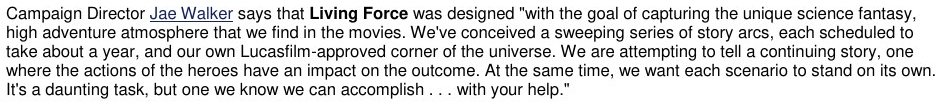

# Owner Material 037 — Star Wars D20 Drive folder (Core, Revised Core and Saga Edition): Living Force Campaign/Campaign Guide/What's the Living Force?.pdf [Star Wars Roleplaying Game Revised Core (d20, 2002)]

- **Source:** Wizards of the Coast Star Wars Roleplaying Game books, web enhancements, Living Force campaign modules and articles (2000–2010), from the owner's "Star Wars D20" Drive folder (only the three edition subfolders; "General" was not read, as instructed). Secondary source (licensed Legends reference). Scan OCR'd on the box; the scan stays box-only and is **not** published.
- **Method:** every scanned page was OCR'd and machine-screened sentence by sentence for power-relevant statements (fights, kills, defeats, Force feats, rankings, superweapons) that name a character on our roster; each kept sentence is quoted verbatim from the OCR text and has a crop of the printed passage directly under it. Pages with nothing power-relevant are still listed with what is on them.
- **Citation:** "*What's the Living Force?* (SWRPG d20 Revised Core), p.X" by printed page ("scan p.X" where no printed number applies). **Weight:** Licensed RPG material: a secondary source. Narrative text sums up Legends lore; game statistics are rules for players, not canon power levels, and rank lowest.

## scan p.1 (scan page 1)

Page contents: Campaign overview: Cularin setting, yearly story arcs, four trilogies per year, launch at Winter Fantasy 2001 ("Eye of the Sun", interactive "An Uneasy Peace"); Campaign Director Jae Walker quote; Campaign Guide plug (hand-read)

- **No single roster character (rules/setting/general)** — entry/section: Campaign Director on Living Force design (Jae Walker, Campaign Director): ""with the goal of capturing the unique science fantasy, high adventure atmosphere that we find in the movies. We've conceived a sweeping series of story arcs, each scheduled to take about a year, and our own Lucasfilm-approved corner of the universe. We are attempting to tell a continuing story, one where the actions of the heroes have an impact on the outcome. At the same time, we want each scenario to stand on its own. It's a daunting task, but one we know we can accomplish . . . with your help."" Source: *What's the Living Force?* (SWRPG d20 Revised Core), scan p.1
  
