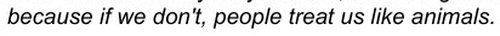

# Owner Material 037 — Star Wars D20 Drive folder (Core, Revised Core and Saga Edition): Locations/Planet Hoppers/A Traveler's Journals of Ralltiir/Part 5 - The Kalmec.pdf [Star Wars Roleplaying Game Revised Core (d20, 2002)]

- **Source:** Wizards of the Coast Star Wars Roleplaying Game books, web enhancements, Living Force campaign modules and articles (2000–2010), from the owner's "Star Wars D20" Drive folder (only the three edition subfolders; "General" was not read, as instructed). Secondary source (licensed Legends reference). Scan OCR'd on the box; the scan stays box-only and is **not** published.
- **Method:** every scanned page was OCR'd and machine-screened sentence by sentence for power-relevant statements (fights, kills, defeats, Force feats, rankings, superweapons) that name a character on our roster; each kept sentence is quoted verbatim from the OCR text and has a crop of the printed passage directly under it. Pages with nothing power-relevant are still listed with what is on them.
- **Citation:** "*Part 5 - The Kalmec* (SWRPG d20 Revised Core), p.X" by printed page ("scan p.X" where no printed number applies). **Weight:** Licensed RPG material: a secondary source. Narrative text sums up Legends lore; game statistics are rules for players, not canon power levels, and rank lowest.

## scan p.1 (scan page 1)

Page contents: Furellas handles Little Kikow's paperwork; Kalmec shaved shoulders; Kikow falls in the crowd at liftoff and Furellas kneels beside him; Kalmec as criminals using an activism cover, rumored Separatist ties; Furellas stats (Soldier 6/Dark Side Marauder 5, CL E) (hand-read)

- **No single roster character (rules/setting/general)** — entry/section: Furellas (via Vareesa) on shaved shoulders: "because if we don't, people treat us like animals." Source: *Part 5 - The Kalmec* (SWRPG d20 Revised Core), scan p.1
  

## scan p.2 (scan page 2)

Page contents: Kalmec Guards stats (Soldier 1/Scoundrel 6, CL C); Dark Side Sourcebook plug; next month Arkania (hand-read)

