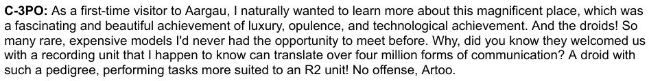
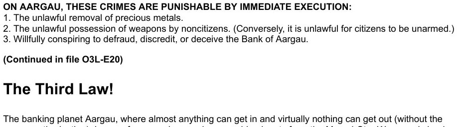

# Owner Material 037 — Star Wars D20 Drive folder (Core, Revised Core and Saga Edition): Locations/Planet Hoppers/Aargau - For All Your Banking Needs/Part 1 - Three Simple Laws.pdf [Star Wars Roleplaying Game Revised Core (d20, 2002)]

- **Source:** Wizards of the Coast Star Wars Roleplaying Game books, web enhancements, Living Force campaign modules and articles (2000–2010), from the owner's "Star Wars D20" Drive folder (only the three edition subfolders; "General" was not read, as instructed). Secondary source (licensed Legends reference). Scan OCR'd on the box; the scan stays box-only and is **not** published.
- **Method:** every scanned page was OCR'd and machine-screened sentence by sentence for power-relevant statements (fights, kills, defeats, Force feats, rankings, superweapons) that name a character on our roster; each kept sentence is quoted verbatim from the OCR text and has a crop of the printed passage directly under it. Pages with nothing power-relevant are still listed with what is on them.
- **Citation:** "*Part 1 - Three Simple Laws* (SWRPG d20 Revised Core), p.X" by printed page ("scan p.X" where no printed number applies). **Weight:** Licensed RPG material: a secondary source. Narrative text sums up Legends lore; game statistics are rules for players, not canon power levels, and rank lowest.

## scan p.1 (scan page 1)

Page contents: Aargau overview: neutral banking world, corruption; Leia faced Vader on Aargau for an Alliance loan; planet stat block (Zug system, pop 4.8 billion); Operation Third Law debriefing, C-3PO on Aargau's droids (hand-read)

- **No single roster character (rules/setting/general)** — entry/section: C-3PO debriefing on Aargau: "As a first-time visitor to Aargau, I naturally wanted to learn more about this magnificent place, which was a fascinating and beautiful achievement of luxury, opulence, and technological achievement. And the droids! So many rare, expensive models I'd never had the opportunity to meet before. Why, did you know they welcomed us with a recording unit that I happen to know can translate over four million forms of communication? A droid with such a pedigree, performing tasks more suited to an R2 unit! No offense, Artoo." Source: *Part 1 - Three Simple Laws* (SWRPG d20 Revised Core), scan p.1
  

### Stat block notes (game mechanics, not feats)

- Vader confronts Leia on Aargau: Not long after escaping Darth Vader's grasp in Cloud City, Princess Leia Organa boldly faced him on Aargau to ensure a much-needed loan for the Alliance. She learned the hard way that such "misdemeanors" included unarmed homicide between off-worlders. (Source: *Part 1 - Three Simple Laws* (SWRPG d20 Revised Core), scan p.1)

## scan p.2 (scan page 2)

Page contents: C-3PO and R2-D2 banter; Agent Syril reads back C-3PO's report (New Escrow roads, Garden of Butterflies); the Three Statutes sign; "The Third Law!" (Marvel #48, Larry Hama), Leia vs. Vader (hand-read)

- **No single roster character (rules/setting/general)** — entry/section: Aargau customs sign (recited by C-3PO): "ON AARGAU, THESE CRIMES ARE PUNISHABLE BY IMMEDIATE EXECUTION: 1. The unlawful removal of precious metals. 2. The unlawful possession of weapons by noncitizens. (Conversely, it is unlawful for citizens to be unarmed.) 3. Willfully conspiring to defraud, discredit, or deceive the Bank of Aargau." Source: *Part 1 - Three Simple Laws* (SWRPG d20 Revised Core), scan p.2
  

## scan p.3 (scan page 3)

Page contents: Comic cover; Vader's assassin-secretary; Leia's density-adjusting gadget; reprint in A Long Time Ago... Vol. 3; Hama, Infantino, Garzon; Part Two teaser (hand-read)

