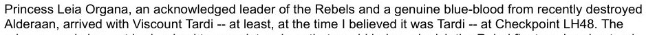
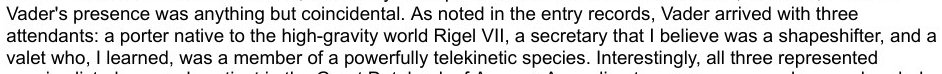

# Owner Material 037 — Star Wars D20 Drive folder (Core, Revised Core and Saga Edition): Locations/Planet Hoppers/Aargau - For All Your Banking Needs/Part 4 - Checks, Balances, and Overdrafts.pdf [Star Wars Roleplaying Game Revised Core (d20, 2002)]

- **Source:** Wizards of the Coast Star Wars Roleplaying Game books, web enhancements, Living Force campaign modules and articles (2000–2010), from the owner's "Star Wars D20" Drive folder (only the three edition subfolders; "General" was not read, as instructed). Secondary source (licensed Legends reference). Scan OCR'd on the box; the scan stays box-only and is **not** published.
- **Method:** every scanned page was OCR'd and machine-screened sentence by sentence for power-relevant statements (fights, kills, defeats, Force feats, rankings, superweapons) that name a character on our roster; each kept sentence is quoted verbatim from the OCR text and has a crop of the printed passage directly under it. Pages with nothing power-relevant are still listed with what is on them.
- **Citation:** "*Part 4 - Checks, Balances, and Overdrafts* (SWRPG d20 Revised Core), p.X" by printed page ("scan p.X" where no printed number applies). **Weight:** Licensed RPG material: a secondary source. Narrative text sums up Legends lore; game statistics are rules for players, not canon power levels, and rank lowest.

## scan p.1 (scan page 1)

Page contents: Trials in absentia, BoA vs. Vader and BoA vs. Organa; Leia's loan; Vader's three assassin-guild attendants (Rigellian porter, shapeshifter secretary, telekinetic valet); Rigellian crushed with a gravitational field disruptor; shapeshifter butterfly stopped by C-3PO and Leia's boot; missile attempt (hand-read)

- **Leia Organa Solo**: "Princess Leia Organa, an acknowledged leader of the Rebels and a genuine blue-blood from recently destroyed Alderaan, arrived with Viscount Tardi -- at least, at the time | believed it was Tardi -- at Checkpoint LH48." Source: *Part 4 - Checks, Balances, and Overdrafts* (SWRPG d20 Revised Core), scan p.1
  
- **Darth Vader (Anakin Skywalker)**: "As noted in the entry records, Vader arrived with three attendants: a porter native to the high-gravity world Rigel VII, a secretary that | believe was a shapeshifter, and a valet who, | learned, was a member of a powerfully telekinetic species." Source: *Part 4 - Checks, Balances, and Overdrafts* (SWRPG d20 Revised Core), scan p.1
  

### Stat block notes (game mechanics, not feats)

- Vader sends three assassins against Leia's party on Aargau: On her heels was Lord Darth Vader, ostensibly on Imperial business. Evidence indicates, however, that Lord Vader's presence was anything but coincidental. As noted in the entry records, Vader arrived with three attendants: a porter native to the high-gravity world Rigel VII, a secretary that I believe was a shapeshifter, and a valet who, I learned, was a member of a powerfully telekinetic species. Interestingly, all three represented species listed as nearly extinct in the Great Databank of Aargau. According to my sources, each was a bonded member of the assassin's guild specializing in unarmed killing. (Source: *Part 4 - Checks, Balances, and Overdrafts* (SWRPG d20 Revised Core), scan p.1)

## scan p.2 (scan page 2)

Page contents: R2-D2 tricks the telekinetic into killing himself; midnight Old Spaceport confrontation; both smuggled weapons in diplomatic pouches; Tardi was an automaton; Vader takes the Crown Jewels of Alderaan; Rolex recommends arrest on sight; Third Law sidebar (repeat) (hand-read)

### Stat block notes (game mechanics, not feats)

- Vader acquires the Crown Jewels of Alderaan: The final element of this curious crime spree caught me completely by surprise, and will likely be impossible to prosecute -- Darth Vader somehow acquired the Crown Jewels of Alderaan, which the princess had put up as collateral for the loan. It appears this was the Sith Lord's goal all along, as Tardi's artificial nature came as no surprise to Vader. Furthermore, no records exist of any transaction that would have left the Jewels in Vader's grasp. (Source: *Part 4 - Checks, Balances, and Overdrafts* (SWRPG d20 Revised Core), scan p.2)

## scan p.3 (scan page 3)

Page contents: Copyright line only (page image) (hand-read)

