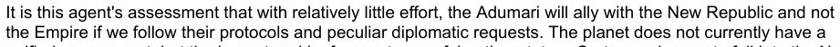

# Owner Material 037 — Star Wars D20 Drive folder (Core, Revised Core and Saga Edition): Locations/Planet Hoppers/Adumar - Pilots Wanted/Part 1 - The Art of the Duel.pdf [Star Wars Roleplaying Game Revised Core (d20, 2002)]

- **Source:** Wizards of the Coast Star Wars Roleplaying Game books, web enhancements, Living Force campaign modules and articles (2000–2010), from the owner's "Star Wars D20" Drive folder (only the three edition subfolders; "General" was not read, as instructed). Secondary source (licensed Legends reference). Scan OCR'd on the box; the scan stays box-only and is **not** published.
- **Method:** every scanned page was OCR'd and machine-screened sentence by sentence for power-relevant statements (fights, kills, defeats, Force feats, rankings, superweapons) that name a character on our roster; each kept sentence is quoted verbatim from the OCR text and has a crop of the printed passage directly under it. Pages with nothing power-relevant are still listed with what is on them.
- **Citation:** "*Part 1 - The Art of the Duel* (SWRPG d20 Revised Core), p.X" by printed page ("scan p.X" where no printed number applies). **Weight:** Licensed RPG material: a secondary source. Narrative text sums up Legends lore; game statistics are rules for players, not canon power levels, and rank lowest.

## scan p.1 (scan page 1)

Page contents: Adumar: Separatist exiles cut off for 10,000 years, an honor-duel culture, Cartann the strongest state; Hallis Saper's "Adumar: Five Years of Union"; Wedge Antilles' team; NRI Agent NRI1 report (Operation Joystick): only pilots accepted as diplomats (hand-read)

- **No single roster character (rules/setting/general)** — entry/section: NRI Agent NRI1 field report (Operation Joystick): "It is this agent's assessment that with relatively little effort, the Adumari will ally with the New Republic and not the Empire if we follow their protocols and peculiar diplomatic requests." Source: *Part 1 - The Art of the Duel* (SWRPG d20 Revised Core), scan p.1
  

## scan p.2 (scan page 2)

Page contents: Planet stats (Katorr system, Wild Space, pop 3.1 billion); Starfighters of Adumar sidebar (Aaron Allston); GM notes: dialect, duels now nonlethal, garish fashion, bonus Exotic Weapon Proficiency (blastsword); Part Two teaser (Hobbie on the Blade-32) (hand-read)

