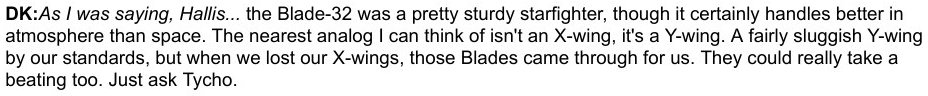

# Owner Material 037 — Star Wars D20 Drive folder (Core, Revised Core and Saga Edition): Locations/Planet Hoppers/Adumar - Pilots Wanted/Part 2 - Four Is Green­-Lighted.pdf [Star Wars Roleplaying Game Revised Core (d20, 2002)]

- **Source:** Wizards of the Coast Star Wars Roleplaying Game books, web enhancements, Living Force campaign modules and articles (2000–2010), from the owner's "Star Wars D20" Drive folder (only the three edition subfolders; "General" was not read, as instructed). Secondary source (licensed Legends reference). Scan OCR'd on the box; the scan stays box-only and is **not** published.
- **Method:** every scanned page was OCR'd and machine-screened sentence by sentence for power-relevant statements (fights, kills, defeats, Force feats, rankings, superweapons) that name a character on our roster; each kept sentence is quoted verbatim from the OCR text and has a crop of the printed passage directly under it. Pages with nothing power-relevant are still listed with what is on them.
- **Citation:** "*Part 2 - Four Is Green­-Lighted* (SWRPG d20 Revised Core), p.X" by printed page ("scan p.X" where no printed number applies). **Weight:** Licensed RPG material: a secondary source. Narrative text sums up Legends lore; game statistics are rules for players, not canon power levels, and rank lowest.

## scan p.1 (scan page 1)

Page contents: Adumari ships lacked hyperdrives; Red Flight flew Blade-32s; interview aboard the Errant Venture (Wedge delayed with Booster); Hobbie compares the Blade-32 to a sluggish Y-wing (hand-read)

- **No single roster character (rules/setting/general)** — entry/section: Derek "Hobbie" Klivian on the Blade-32: "the Blade-32 was a pretty sturdy starfighter, though it certainly handles better in atmosphere than space. The nearest analog I can think of isn't an X-wing, it's a Y-wing. A fairly sluggish Y-wing by our standards, but when we lost our X-wings, those Blades came through for us. They could really take a beating too. Just ask Tycho." Source: *Part 2 - Four Is Green­-Lighted* (SWRPG d20 Revised Core), scan p.1
  

## scan p.2 (scan page 2)

Page contents: Blade-34 prototypes; the perator's wage increases; Hobbie: "people living in dignity rather than holes"; GM notes (crimson in honor of Red Flight, -2 penalty for non-Adumari pilots for 40 hours); Blade-32 stats; Part Three teaser (Wes Janson's honor duel, blastsword) (hand-read)

## scan p.3 (scan page 3)

Page contents: Blank page (hand-read)

