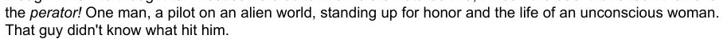
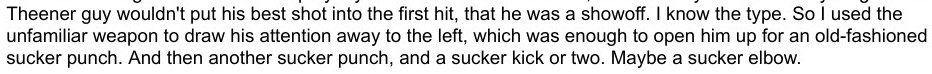

# Owner Material 037 — Star Wars D20 Drive folder (Core, Revised Core and Saga Edition): Locations/Planet Hoppers/Adumar - Pilots Wanted/Part 3 - Three, Ready For a Furball.pdf [Star Wars Roleplaying Game Revised Core (d20, 2002)]

- **Source:** Wizards of the Coast Star Wars Roleplaying Game books, web enhancements, Living Force campaign modules and articles (2000–2010), from the owner's "Star Wars D20" Drive folder (only the three edition subfolders; "General" was not read, as instructed). Secondary source (licensed Legends reference). Scan OCR'd on the box; the scan stays box-only and is **not** published.
- **Method:** every scanned page was OCR'd and machine-screened sentence by sentence for power-relevant statements (fights, kills, defeats, Force feats, rankings, superweapons) that name a character on our roster; each kept sentence is quoted verbatim from the OCR text and has a crop of the printed passage directly under it. Pages with nothing power-relevant are still listed with what is on them.
- **Citation:** "*Part 3 - Three, Ready For a Furball* (SWRPG d20 Revised Core), p.X" by printed page ("scan p.X" where no printed number applies). **Weight:** Licensed RPG material: a secondary source. Narrative text sums up Legends lore; game statistics are rules for players, not canon power levels, and rank lowest.

## scan p.1 (scan page 1)

Page contents: Adumari protocols and honor duels; Saper footage; Wes claims credit for ending lethal duels; Cheriss ke Hanadi, heartbroken blastsword champion, taking every challenger (hand-read)

- **No single roster character (rules/setting/general)** — entry/section: Wes Janson on the duel: "One man, a pilot on an alien world, standing up for honor and the life of an unconscious woman. That guy didn't know what hit him." Source: *Part 3 - Three, Ready For a Furball* (SWRPG d20 Revised Core), scan p.1
  

## scan p.2 (scan page 2)

Page contents: Wes challenges Thanaer ke Sekae (insults, with Darpen's bad advice); blastsword description; wins with sucker punches; GM notes: blastsword exported to collectors and "at least one Jedi Master" (hand-read)

- **No single roster character (rules/setting/general)** — entry/section: Wes Janson on winning the duel: "So I used the unfamiliar weapon to draw his attention away to the left, which was enough to open him up for an old-fashioned sucker punch. And then another sucker punch, and a sucker kick or two. Maybe a sucker elbow." Source: *Part 3 - Three, Ready For a Furball* (SWRPG d20 Revised Core), scan p.2
  

## scan p.3 (scan page 3)

Page contents: Adumari blastsword stats (1,200 credcoins, 1d6, crit x3 + stun, blast tip); Part Four teaser (Tycho on Cheriss) (hand-read)

