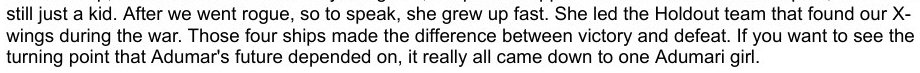

# Owner Material 037 — Star Wars D20 Drive folder (Core, Revised Core and Saga Edition): Locations/Planet Hoppers/Adumar - Pilots Wanted/Part 4 - Two Standing By, One Hundred Percent.pdf [Star Wars Roleplaying Game Revised Core (d20, 2002)]

- **Source:** Wizards of the Coast Star Wars Roleplaying Game books, web enhancements, Living Force campaign modules and articles (2000–2010), from the owner's "Star Wars D20" Drive folder (only the three edition subfolders; "General" was not read, as instructed). Secondary source (licensed Legends reference). Scan OCR'd on the box; the scan stays box-only and is **not** published.
- **Method:** every scanned page was OCR'd and machine-screened sentence by sentence for power-relevant statements (fights, kills, defeats, Force feats, rankings, superweapons) that name a character on our roster; each kept sentence is quoted verbatim from the OCR text and has a crop of the printed passage directly under it. Pages with nothing power-relevant are still listed with what is on them.
- **Citation:** "*Part 4 - Two Standing By, One Hundred Percent* (SWRPG d20 Revised Core), p.X" by printed page ("scan p.X" where no printed number applies). **Weight:** Licensed RPG material: a secondary source. Narrative text sums up Legends lore; game statistics are rules for players, not canon power levels, and rank lowest.

## scan p.1 (scan page 1)

Page contents: Cheriss's background (vertigo cured, NR academy); Tycho trained her on A-wings; she led the Holdout team that found Red Flight's X-wings; Wedge arrives ("Even Luke fell for that") (hand-read)

- **No single roster character (rules/setting/general)** — entry/section: Tycho Celchu on Cheriss ke Hanadi: "She led the Holdout team that found our Xwings during the war. Those four ships made the difference between victory and defeat. If you want to see the turning point that Adumar's future depended on, it really all came down to one Adumari girl." Source: *Part 4 - Two Standing By, One Hundred Percent* (SWRPG d20 Revised Core), scan p.1
  

## scan p.2 (scan page 2)

Page contents: Cheriss in Moonlight squadron (A-wing, Mon Carima), +5 Rep on Adumar; stats Scoundrel 9/Soldier 3 (17 years after Episode IV); Part Five teaser (hand-read)

