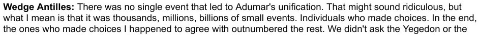
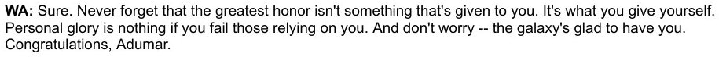

# Owner Material 037 — Star Wars D20 Drive folder (Core, Revised Core and Saga Edition): Locations/Planet Hoppers/Adumar - Pilots Wanted/Part 5 - Leader Has Two Lit and In the Green.pdf [Star Wars Roleplaying Game Revised Core (d20, 2002)]

- **Source:** Wizards of the Coast Star Wars Roleplaying Game books, web enhancements, Living Force campaign modules and articles (2000–2010), from the owner's "Star Wars D20" Drive folder (only the three edition subfolders; "General" was not read, as instructed). Secondary source (licensed Legends reference). Scan OCR'd on the box; the scan stays box-only and is **not** published.
- **Method:** every scanned page was OCR'd and machine-screened sentence by sentence for power-relevant statements (fights, kills, defeats, Force feats, rankings, superweapons) that name a character on our roster; each kept sentence is quoted verbatim from the OCR text and has a crop of the printed passage directly under it. Pages with nothing power-relevant are still listed with what is on them.
- **Citation:** "*Part 5 - Leader Has Two Lit and In the Green* (SWRPG d20 Revised Core), p.X" by printed page ("scan p.X" where no printed number applies). **Weight:** Licensed RPG material: a secondary source. Narrative text sums up Legends lore; game statistics are rules for players, not canon power levels, and rank lowest.

## scan p.1 (scan page 1)

Page contents: Wedge: unification came from billions of small choices (Yedagon, Halbegardian, Balass ke Rassa); meeting Rogriss in a bar, both in a crisis of honor; Rogriss sends the Agonizer away; Wedge's message to the Adumari Union (hand-read)

- **No single roster character (rules/setting/general)** — entry/section: Wedge Antilles on unification: "There was no single event that led to Adumar's unification. That might sound ridiculous, but what I mean is that it was thousands, millions, billions of small events. Individuals who made choices." Source: *Part 5 - Leader Has Two Lit and In the Green* (SWRPG d20 Revised Core), scan p.1
  
- **No single roster character (rules/setting/general)** — entry/section: Wedge Antilles to the Adumari Union: "Never forget that the greatest honor isn't something that's given to you. It's what you give yourself. Personal glory is nothing if you fail those relying on you. And don't worry -- the galaxy's glad to have you. Congratulations, Adumar." Source: *Part 5 - Leader Has Two Lit and In the Green* (SWRPG d20 Revised Core), scan p.1
  

## scan p.2 (scan page 2)

Page contents: GM notes: Teren Rogriss (kept the Agonizer, secretly aided Solo against Zsinj, now defense minister to perator Balass ke Teldan); stats Soldier 5/Noble 4/Officer 5; Hapes teaser for May (hand-read)

