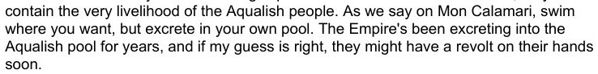

# Owner Material 037 — Star Wars D20 Drive folder (Core, Revised Core and Saga Edition): Locations/Planet Hoppers/Ando - Planet of the Walrus Men/Part 1 - Any Port in a Storm.pdf [Star Wars Roleplaying Game Revised Core (d20, 2002)]

- **Source:** Wizards of the Coast Star Wars Roleplaying Game books, web enhancements, Living Force campaign modules and articles (2000–2010), from the owner's "Star Wars D20" Drive folder (only the three edition subfolders; "General" was not read, as instructed). Secondary source (licensed Legends reference). Scan OCR'd on the box; the scan stays box-only and is **not** published.
- **Method:** every scanned page was OCR'd and machine-screened sentence by sentence for power-relevant statements (fights, kills, defeats, Force feats, rankings, superweapons) that name a character on our roster; each kept sentence is quoted verbatim from the OCR text and has a crop of the printed passage directly under it. Pages with nothing power-relevant are still listed with what is on them.
- **Citation:** "*Part 1 - Any Port in a Storm* (SWRPG d20 Revised Core), p.X" by printed page ("scan p.X" where no printed number applies). **Weight:** Licensed RPG material: a secondary source. Narrative text sums up Legends lore; game statistics are rules for players, not canon power levels, and rank lowest.

## scan p.1 (scan page 1)

Page contents: Archivist's note on Sissalik; Ando stats (Mid Rim, pop 850,000, Imperial military administration); log, 3rd Day of Freedom: Farvakine killed with chuba poison, shuttle sunk near Quantill City, growing Aqualish unrest (hand-read)

- **No single roster character (rules/setting/general)** — entry/section: Sissalik's log on the Empire on Ando: "As we say on Mon Calamari, swim where you want, but excrete in your own pool. The Empire's been excreting into the Aqualish pool for years, and if my guess is right, they might have a revolt on their hands soon." Source: *Part 1 - Any Port in a Storm* (SWRPG d20 Revised Core), scan p.1
  

## scan p.2 (scan page 2)

Page contents: Ando technology copied from ancient Republic scout ships; three breeds (Aquala, Quara, Ualaq); Quantill dock cantina; Imperial interdictor craft; Part Two teaser (Captain Bippi Bogzider, Nanda's Luck) (hand-read)

