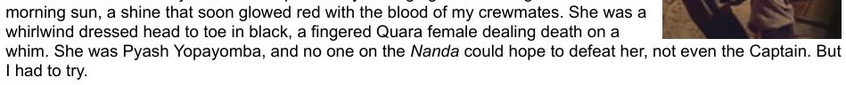

# Owner Material 037 — Star Wars D20 Drive folder (Core, Revised Core and Saga Edition): Locations/Planet Hoppers/Ando - Planet of the Walrus Men/Part 4 - She Is the Pirate Queen.pdf [Star Wars Roleplaying Game Revised Core (d20, 2002)]

- **Source:** Wizards of the Coast Star Wars Roleplaying Game books, web enhancements, Living Force campaign modules and articles (2000–2010), from the owner's "Star Wars D20" Drive folder (only the three edition subfolders; "General" was not read, as instructed). Secondary source (licensed Legends reference). Scan OCR'd on the box; the scan stays box-only and is **not** published.
- **Method:** every scanned page was OCR'd and machine-screened sentence by sentence for power-relevant statements (fights, kills, defeats, Force feats, rankings, superweapons) that name a character on our roster; each kept sentence is quoted verbatim from the OCR text and has a crop of the printed passage directly under it. Pages with nothing power-relevant are still listed with what is on them.
- **Citation:** "*Part 4 - She Is the Pirate Queen* (SWRPG d20 Revised Core), p.X" by printed page ("scan p.X" where no printed number applies). **Weight:** Licensed RPG material: a secondary source. Narrative text sums up Legends lore; game statistics are rules for players, not canon power levels, and rank lowest.

## scan p.1 (scan page 1)

Page contents: Shore leave at Natamee; black repulsor-fin pirate ship strikes at dawn; bridge hit, Bippi wounded; boarders; Pyash Yopayomba (Quara) with a vibroblade; stats Scoundrel 6/Noble 3/Crime Lord 9 (CL G), contacts include the Imperial governor of Ando (hand-read)

- **No single roster character (rules/setting/general)** — entry/section: Sissalik's log on Pyash Yopayomba: "She was a whirlwind dressed head to toe in black, a fingered Quara female dealing death on a whim. She was Pyash Yopayomba, and no one on the Nanda could hope to defeat her, not even the Captain. But I had to try." Source: *Part 4 - She Is the Pirate Queen* (SWRPG d20 Revised Core), scan p.1
  

## scan p.2 (scan page 2)

Page contents: Pyash skills, feats (Whirlwind Attack, Infamy); Part Five teaser (Festival of the Portage Moon); Zygerrian slave ring adventure plug (hand-read)

