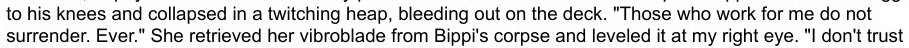

# Owner Material 037 — Star Wars D20 Drive folder (Core, Revised Core and Saga Edition): Locations/Planet Hoppers/Ando - Planet of the Walrus Men/Part 5 - Portage Moon.pdf [Star Wars Roleplaying Game Revised Core (d20, 2002)]

- **Source:** Wizards of the Coast Star Wars Roleplaying Game books, web enhancements, Living Force campaign modules and articles (2000–2010), from the owner's "Star Wars D20" Drive folder (only the three edition subfolders; "General" was not read, as instructed). Secondary source (licensed Legends reference). Scan OCR'd on the box; the scan stays box-only and is **not** published.
- **Method:** every scanned page was OCR'd and machine-screened sentence by sentence for power-relevant statements (fights, kills, defeats, Force feats, rankings, superweapons) that name a character on our roster; each kept sentence is quoted verbatim from the OCR text and has a crop of the printed passage directly under it. Pages with nothing power-relevant are still listed with what is on them.
- **Citation:** "*Part 5 - Portage Moon* (SWRPG d20 Revised Core), p.X" by printed page ("scan p.X" where no printed number applies). **Weight:** Licensed RPG material: a secondary source. Narrative text sums up Legends lore; game statistics are rules for players, not canon power levels, and rank lowest.

## scan p.1 (scan page 1)

Page contents: Battle of Portage Moon framing; Pyash spares Slick and kills Bippi; 6th Day of Servitude: Nanda loaded with explosives to ram Quantill port during the festival and frame Aquala extremists, at the Imperial Governor's promise; Slick plans to steer manually into the Majestic (hand-read)

- **No single roster character (rules/setting/general)** — entry/section: Pyash Yopayomba to Slick: "Those who work for me do not surrender. Ever." Source: *Part 5 - Portage Moon* (SWRPG d20 Revised Core), scan p.1
  

## scan p.2 (scan page 2)

Page contents: Final entry sealed in a cuttlewine bottle with an open comlink; August teaser (Aargau); Galactic Campaign Guide plug (hand-read)

- **No single roster character (rules/setting/general)** — entry/section: Sissalik's last journal entry: "Maybe if the Aqualish understand how close they've come to a worldwide war, they'll try to show a little more unity. Maybe, with time, they really will try to throw off the yoke of oppression. Wish I could see it." Source: *Part 5 - Portage Moon* (SWRPG d20 Revised Core), scan p.2
  
