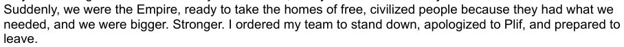
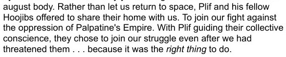

# Owner Material 037 — Star Wars D20 Drive folder (Core, Revised Core and Saga Edition): Locations/Planet Hoppers/Arbra - Sanctuary In the Storm/Part 2 - Judge Him Not By His Size.pdf [Star Wars Roleplaying Game Revised Core (d20, 2002)]

- **Source:** Wizards of the Coast Star Wars Roleplaying Game books, web enhancements, Living Force campaign modules and articles (2000–2010), from the owner's "Star Wars D20" Drive folder (only the three edition subfolders; "General" was not read, as instructed). Secondary source (licensed Legends reference). Scan OCR'd on the box; the scan stays box-only and is **not** published.
- **Method:** every scanned page was OCR'd and machine-screened sentence by sentence for power-relevant statements (fights, kills, defeats, Force feats, rankings, superweapons) that name a character on our roster; each kept sentence is quoted verbatim from the OCR text and has a crop of the printed passage directly under it. Pages with nothing power-relevant are still listed with what is on them.
- **Citation:** "*Part 2 - Judge Him Not By His Size* (SWRPG d20 Revised Core), p.X" by printed page ("scan p.X" where no printed number applies). **Weight:** Licensed RPG material: a secondary source. Narrative text sums up Legends lore; game statistics are rules for players, not canon power levels, and rank lowest.

## scan p.1 (scan page 1)

Page contents: Hoojib description; Leia's nomination speech: the slivilith, Rebels nearly seizing the grottoes, Hoojibs share their home; Plif stats from the page image: Male Hoojib Diplomat 10/Noble 2, Def 18 (+4 class, +4 size), Spd 4 m, VP/WP 4/4, Attack +7/+2 melee (1 pt, bite) or +10/+5 ranged, CL C (hand-read)

- **No single roster character (rules/setting/general)** — entry/section: Leia Organa's speech nominating Plif: "Suddenly, we were the Empire, ready to take the homes of free, civilized people because they had what we needed, and we were bigger. Stronger. I ordered my team to stand down, apologized to Plif, and prepared to leave." Source: *Part 2 - Judge Him Not By His Size* (SWRPG d20 Revised Core), scan p.1
  
- **No single roster character (rules/setting/general)** — entry/section: Leia Organa's speech nominating Plif: "Rather than let us return to space, Plif and his fellow Hoojibs offered to share their home with us. To join our fight against the oppression of Palpatine's Empire. With Plif guiding their collective conscience, they chose to join our struggle even after we had threatened them . . . because it was the right thing to do." Source: *Part 2 - Judge Him Not By His Size* (SWRPG d20 Revised Core), scan p.1
  

## scan p.2 (scan page 2)

Page contents: Energy Drain and Telepathy rules; Marvel and Alien Anthology refs; Part Three teaser (C-3PO and an ancient evil); revised core second printing errata plug (hand-read)

