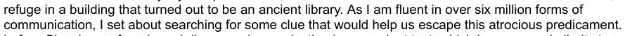
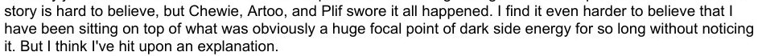

# Owner Material 037 — Star Wars D20 Drive folder (Core, Revised Core and Saga Edition): Locations/Planet Hoppers/Arbra - Sanctuary In the Storm/Part 3 - The Darker.pdf [Star Wars Roleplaying Game Revised Core (d20, 2002)]

- **Source:** Wizards of the Coast Star Wars Roleplaying Game books, web enhancements, Living Force campaign modules and articles (2000–2010), from the owner's "Star Wars D20" Drive folder (only the three edition subfolders; "General" was not read, as instructed). Secondary source (licensed Legends reference). Scan OCR'd on the box; the scan stays box-only and is **not** published.
- **Method:** every scanned page was OCR'd and machine-screened sentence by sentence for power-relevant statements (fights, kills, defeats, Force feats, rankings, superweapons) that name a character on our roster; each kept sentence is quoted verbatim from the OCR text and has a crop of the printed passage directly under it. Pages with nothing power-relevant are still listed with what is on them.
- **Citation:** "*Part 3 - The Darker* (SWRPG d20 Revised Core), p.X" by printed page ("scan p.X" where no printed number applies). **Weight:** Licensed RPG material: a secondary source. Narrative text sums up Legends lore; game statistics are rules for players, not canon power levels, and rank lowest.

## scan p.1 (scan page 1)

Page contents: Debrief RA44390/C-3PO: R2 lured into an ancient Xim-era city under the base; the Darker (cast-off negative emotions of ancient Arbrans) turns Chewbacca; C-3PO finds the answer in an ancient text resembling Sith; the Darker forced into the field, city collapses (hand-read)

- **No single roster character (rules/setting/general)** — entry/section: C-3PO's debriefing: "As I am fluent in over six million forms of communication, I set about searching for some clue that would help us escape this atrocious predicament." Source: *Part 3 - The Darker* (SWRPG d20 Revised Core), scan p.1
  

## scan p.2 (scan page 2)

Page contents: Luke's log: a dark side focal point under the base; crystals possibly powered by the Force balancing the Darker; Part Four teaser (modified TIE infiltration); Pinett mini-adventure plug (hand-read)

- **No single roster character (rules/setting/general)** — entry/section: Luke Skywalker's personal log: "I find it even harder to believe that I have been sitting on top of what was obviously a huge focal point of dark side energy for so long without noticing it." Source: *Part 3 - The Darker* (SWRPG d20 Revised Core), scan p.2
  

### Stat block notes (game mechanics, not feats)

- Luke recalls Yoda's teaching on balance: Master Yoda spoke often of the importance of balance. At the time, I had supposed he was giving me fencing instructions, but it may have been something more. The Force may require balance, need balance, in some ways. (Source: *Part 3 - The Darker* (SWRPG d20 Revised Core), scan p.2)
