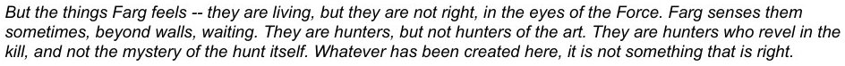

# Owner Material 037 — Star Wars D20 Drive folder (Core, Revised Core and Saga Edition): Locations/Planet Hoppers/Arkanian Chill/Part 4 - The Re-Engineered.pdf [Star Wars Roleplaying Game Revised Core (d20, 2002)]

- **Source:** Wizards of the Coast Star Wars Roleplaying Game books, web enhancements, Living Force campaign modules and articles (2000–2010), from the owner's "Star Wars D20" Drive folder (only the three edition subfolders; "General" was not read, as instructed). Secondary source (licensed Legends reference). Scan OCR'd on the box; the scan stays box-only and is **not** published.
- **Method:** every scanned page was OCR'd and machine-screened sentence by sentence for power-relevant statements (fights, kills, defeats, Force feats, rankings, superweapons) that name a character on our roster; each kept sentence is quoted verbatim from the OCR text and has a crop of the printed passage directly under it. Pages with nothing power-relevant are still listed with what is on them.
- **Citation:** "*Part 4 - The Re-Engineered* (SWRPG d20 Revised Core), p.X" by printed page ("scan p.X" where no printed number applies). **Weight:** Licensed RPG material: a secondary source. Narrative text sums up Legends lore; game statistics are rules for players, not canon power levels, and rank lowest.

## scan p.1 (scan page 1)

Page contents: Farg uses a captured Arkanian scientist ("We have made life"); senses wrong hunters; witch moving; Re-engineered template (Treat Injury DC 30 + 2x level, +2 natural armor, Toughness, ability shifts, Unnatural Aura table) (hand-read)

- **No single roster character (rules/setting/general)** — entry/section: Farg's journal on the Re-engineered: "They are hunters, but not hunters of the art. They are hunters who revel in the kill, and not the mystery of the hunt itself. Whatever has been created here, it is not something that is right." Source: *Part 4 - The Re-Engineered* (SWRPG d20 Revised Core), scan p.1
  

## scan p.2 (scan page 2)

Page contents: Aura table continued; See Force detects wrongness; Ferocious +2 melee; CL +1; sample Re-Engineered Trandoshan Thug 3; March teaser (Velmor, Marvel issue 49) (hand-read)

