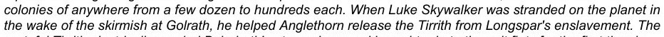

# Owner Material 037 — Star Wars D20 Drive folder (Core, Revised Core and Saga Edition): Locations/Planet Hoppers/Beheboth - Blood and Water/Part 1 - Return to Prosperity.pdf [Star Wars Roleplaying Game Revised Core (d20, 2002)]

- **Source:** Wizards of the Coast Star Wars Roleplaying Game books, web enhancements, Living Force campaign modules and articles (2000–2010), from the owner's "Star Wars D20" Drive folder (only the three edition subfolders; "General" was not read, as instructed). Secondary source (licensed Legends reference). Scan OCR'd on the box; the scan stays box-only and is **not** published.
- **Method:** every scanned page was OCR'd and machine-screened sentence by sentence for power-relevant statements (fights, kills, defeats, Force feats, rankings, superweapons) that name a character on our roster; each kept sentence is quoted verbatim from the OCR text and has a crop of the printed passage directly under it. Pages with nothing power-relevant are still listed with what is on them.
- **Citation:** "*Part 1 - Return to Prosperity* (SWRPG d20 Revised Core), p.X" by printed page ("scan p.X" where no printed number applies). **Weight:** Licensed RPG material: a secondary source. Narrative text sums up Legends lore; game statistics are rules for players, not canon power levels, and rank lowest.

## scan p.1 (scan page 1)

Page contents: Beheboth history (Bothan colony, Human settlers, mild mutations, warlord Gideon Longspar); Senator Darial Anglethorn, peacekeeper of Prosperity (formerly Garrotine); Tirrith gaseous energy beings who brought rain; Luke arrives months after the Solo wedding; planet stats; Marvel Simonson-era sidebar (Shira Brie) (hand-read)

- **Luke Skywalker**: "When Luke Skywalker was stranded on the planet in the wake of the skirmish at Golrath, he helped Anglethorn release the Tirrith from Longspar's enslavement." Source: *Part 1 - Return to Prosperity* (SWRPG d20 Revised Core), scan p.1
  

## scan p.2 (scan page 2)

Page contents: Sidebar ends (Dark Horse A Long Time Ago... vol 4); Luke's journal Day 1: pirates damage his X-wing; he feels 100+ Tirrith die; microtherm bomb site in Prosperity; heals Darial with Chu'unthor techniques; suspects she is Force-sensitive; Part Two teaser (hand-read)

- **No single roster character (rules/setting/general)** — entry/section: Luke Skywalker's personal journal: "I've had some bad landings, but this beat all of them except my first trip to Dagobah" Source: *Part 1 - Return to Prosperity* (SWRPG d20 Revised Core), scan p.2
  

## scan p.3 (scan page 3)

Page contents: Ultimate Adversaries plug (vrblther, Nar Shaddaa); copyright (hand-read)

