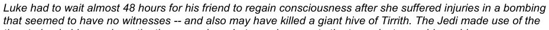

# Owner Material 037 — Star Wars D20 Drive folder (Core, Revised Core and Saga Edition): Locations/Planet Hoppers/Beheboth - Blood and Water/Part 2 - Who Slew Berl Matoone?.pdf [Star Wars Roleplaying Game Revised Core (d20, 2002)]

- **Source:** Wizards of the Coast Star Wars Roleplaying Game books, web enhancements, Living Force campaign modules and articles (2000–2010), from the owner's "Star Wars D20" Drive folder (only the three edition subfolders; "General" was not read, as instructed). Secondary source (licensed Legends reference). Scan OCR'd on the box; the scan stays box-only and is **not** published.
- **Method:** every scanned page was OCR'd and machine-screened sentence by sentence for power-relevant statements (fights, kills, defeats, Force feats, rankings, superweapons) that name a character on our roster; each kept sentence is quoted verbatim from the OCR text and has a crop of the printed passage directly under it. Pages with nothing power-relevant are still listed with what is on them.
- **Citation:** "*Part 2 - Who Slew Berl Matoone?* (SWRPG d20 Revised Core), p.X" by printed page ("scan p.X" where no printed number applies). **Weight:** Licensed RPG material: a secondary source. Narrative text sums up Legends lore; game statistics are rules for players, not canon power levels, and rank lowest.

## scan p.1 (scan page 1)

Page contents: Berl Matoone found dead on Darial's vaporator fields with his blood turned uniformly toxic; Dr. Hower Jerimott's report; Darial suspects the Tirrith (silent for years, drought); heads to the NR base in Longspar's old fortress after messaging Luke (hand-read)

- **Luke Skywalker**: "Luke had to wait almost 48 hours for his friend to regain consciousness after she suffered injuries in a bombing that seemed to have no witnesses -- and also may have killed a giant hive of Tirrith." Source: *Part 2 - Who Slew Berl Matoone?* (SWRPG d20 Revised Core), scan p.1
  

## scan p.2 (scan page 2)

Page contents: Darial GM notes (unknowing Force-sensitive, Empathy); stats Fringer 6/Noble 4/Scout 2, CL F; Peacekeeper quality; Marvel panel from the image: "-- But why do you want me to protect it? You've already got more armed guards than a bankers' convention on Aargau!" / "Maybe. But I sense something special about you, Luke. Will you help?"; Part Three teaser (Mils Giel, ex-Imperial) (hand-read)

