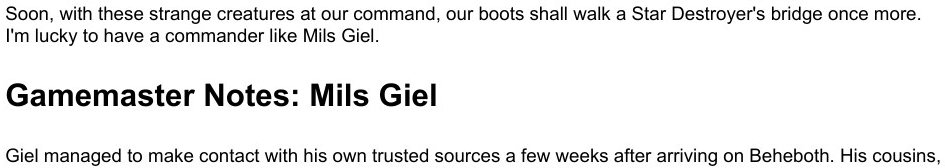

# Owner Material 037 — Star Wars D20 Drive folder (Core, Revised Core and Saga Edition): Locations/Planet Hoppers/Beheboth - Blood and Water/Part 3 - The Tirrith Trap.pdf [Star Wars Roleplaying Game Revised Core (d20, 2002)]

- **Source:** Wizards of the Coast Star Wars Roleplaying Game books, web enhancements, Living Force campaign modules and articles (2000–2010), from the owner's "Star Wars D20" Drive folder (only the three edition subfolders; "General" was not read, as instructed). Secondary source (licensed Legends reference). Scan OCR'd on the box; the scan stays box-only and is **not** published.
- **Method:** every scanned page was OCR'd and machine-screened sentence by sentence for power-relevant statements (fights, kills, defeats, Force feats, rankings, superweapons) that name a character on our roster; each kept sentence is quoted verbatim from the OCR text and has a crop of the printed passage directly under it. Pages with nothing power-relevant are still listed with what is on them.
- **Citation:** "*Part 3 - The Tirrith Trap* (SWRPG d20 Revised Core), p.X" by printed page ("scan p.X" where no printed number applies). **Weight:** Licensed RPG material: a secondary source. Narrative text sums up Legends lore; game statistics are rules for players, not canon power levels, and rank lowest.

## scan p.1 (scan page 1)

Page contents: Golrath photoreceptive bedrock; Giel tries to trap Leia, fails; shoots Luke's X-wing; crash-lands on Beheboth with Sgt. Malka; Malka's log, Day 1,825: Quarren scientist dead, Tirrith bred into killers, Rebel outpost wiped out, plan to destroy Prosperity; restraint-globe description; GM notes (Ralltiir cousins) (hand-read)

- **No single roster character (rules/setting/general)** — entry/section: Sgt. Malka's log: "Soon, with these strange creatures at our command, our boots shall walk a Star Destroyer's bridge once more. I'm lucky to have a commander like Mils Giel." Source: *Part 3 - The Tirrith Trap* (SWRPG d20 Revised Core), scan p.1
  

### Stat block notes (game mechanics, not feats)

- Vader demoted Giel after the Teezl: After the Teezl incident, Mils Giel (whom Darth Vader personally demoted from Admiral to Lieutenant for losing the priceless creature to saboteurs) found himself in charge of a survey team performing a thorough inspection on the former Rebel base world Golrath. (Source: *Part 3 - The Tirrith Trap* (SWRPG d20 Revised Core), scan p.1)

## scan p.2 (scan page 2)

Page contents: Giel's moisture farm cover; stats Soldier 6/Noble 1/Officer 4/Fringer 2, DSP 18, CL F; Part Four teaser (hand-read)

