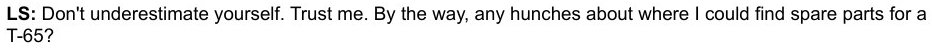

# Owner Material 037 — Star Wars D20 Drive folder (Core, Revised Core and Saga Edition): Locations/Planet Hoppers/Beheboth - Blood and Water/Part 4 - Hit and Mist.pdf [Star Wars Roleplaying Game Revised Core (d20, 2002)]

- **Source:** Wizards of the Coast Star Wars Roleplaying Game books, web enhancements, Living Force campaign modules and articles (2000–2010), from the owner's "Star Wars D20" Drive folder (only the three edition subfolders; "General" was not read, as instructed). Secondary source (licensed Legends reference). Scan OCR'd on the box; the scan stays box-only and is **not** published.
- **Method:** every scanned page was OCR'd and machine-screened sentence by sentence for power-relevant statements (fights, kills, defeats, Force feats, rankings, superweapons) that name a character on our roster; each kept sentence is quoted verbatim from the OCR text and has a crop of the printed passage directly under it. Pages with nothing power-relevant are still listed with what is on them.
- **Citation:** "*Part 4 - Hit and Mist* (SWRPG d20 Revised Core), p.X" by printed page ("scan p.X" where no printed number applies). **Weight:** Licensed RPG material: a secondary source. Narrative text sums up Legends lore; game statistics are rules for players, not canon power levels, and rank lowest.

## scan p.1 (scan page 1)

Page contents: Outpost B-2 staff poisoned; Luke's journal Day 3, transcript for General Cracken; Darial traced Giel and Malka to a fake farm with a dead Quarren; panel balloons from the image: "He's a stranger -- and that's all we know!" plus a second balloon cropped at the panel edge ("For pity's sake! Brigands have ...thing else from commerce ...lives") (hand-read)

- **Luke Skywalker** — entry/section: Luke Skywalker's Personal Journal: "Luke Skywalker: From the look of things, you just would have been killed, too." Source: *Part 4 - Hit and Mist* (SWRPG d20 Revised Core), scan p.1
  

## scan p.2 (scan page 2)

Page contents: Darial's account: cut off the hauler, Giel shoves Malka into her fire, Giel triggers a tank's kill system and escapes in the Quarren's ship; impoundment transmitter lets them track it; Luke encourages her Force potential (hand-read)

- **No single roster character (rules/setting/general)** — entry/section: Luke Skywalker to Darial Anglethorn: "Don't underestimate yourself. Trust me. By the way, any hunches about where I could find spare parts for a T-65?" Source: *Part 4 - Hit and Mist* (SWRPG d20 Revised Core), scan p.2
  

## scan p.3 (scan page 3)

Page contents: GM notes: Dr. Kimp Minmirn's mutations; restraint cage kill system (DC 30, 6d6 blast); mutant Tirrith hive stats (CL I) with Molecular Healing, Mind Scream, Mutant Empathy, Poisonous Gas, Telepathy; Star Wars Gamer #7 ref (hand-read)

## scan p.4 (scan page 4)

Page contents: Break notice; July 22 return with "The Big Red One" (Yavin, Rodian treasure hunter); Jedi Counseling plug (hand-read)

