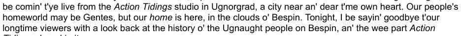

# Owner Material 037 — Star Wars D20 Drive folder (Core, Revised Core and Saga Edition): Locations/Planet Hoppers/Bespin - Action Tidings/Part 1 - Live From the Surface.pdf [Star Wars Roleplaying Game Revised Core (d20, 2002)]

- **Source:** Wizards of the Coast Star Wars Roleplaying Game books, web enhancements, Living Force campaign modules and articles (2000–2010), from the owner's "Star Wars D20" Drive folder (only the three edition subfolders; "General" was not read, as instructed). Secondary source (licensed Legends reference). Scan OCR'd on the box; the scan stays box-only and is **not** published.
- **Method:** every scanned page was OCR'd and machine-screened sentence by sentence for power-relevant statements (fights, kills, defeats, Force feats, rankings, superweapons) that name a character on our roster; each kept sentence is quoted verbatim from the OCR text and has a crop of the printed passage directly under it. Pages with nothing power-relevant are still listed with what is on them.
- **Citation:** "*Part 1 - Live From the Surface* (SWRPG d20 Revised Core), p.X" by printed page ("scan p.X" where no printed number applies). **Weight:** Licensed RPG material: a secondary source. Narrative text sums up Legends lore; game statistics are rules for players, not canon power levels, and rank lowest.

## scan p.1 (scan page 1)

Page contents: Ugnaught tribes (Irden, Botrut, Isced) brought by Ecclessis Figg; Ars Fivvle retires after "Ugnaughts' Progress"; Bespin stats; transcribot (Serv-O-Droid ERL-21) framing (hand-read)

## scan p.2 (scan page 2)

Page contents: Fivvle's opening from Ugnorgrad; autobiographical montage; GM notes: Action Tidings history, Treece's Imperial troops expelled; stats Expert 3/Diplomat 5, 146 years old, CL A (hand-read)

- **No single roster character (rules/setting/general)** — entry/section: Ars Fivvle on Action Tidings: "Our people's homeworld may be Gentes, but our home is here, in the clouds o' Bespin." Source: *Part 1 - Live From the Surface* (SWRPG d20 Revised Core), scan p.2
  

## scan p.3 (scan page 3)

Page contents: Part Two teaser (the Surface built from Cloud City leftovers); TCG Bespin deck plug (hand-read)

