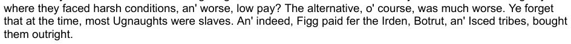

# Owner Material 037 — Star Wars D20 Drive folder (Core, Revised Core and Saga Edition): Locations/Planet Hoppers/Bespin - Action Tidings/Part 2 - That Den o' Human Iniquity.pdf [Star Wars Roleplaying Game Revised Core (d20, 2002)]

- **Source:** Wizards of the Coast Star Wars Roleplaying Game books, web enhancements, Living Force campaign modules and articles (2000–2010), from the owner's "Star Wars D20" Drive folder (only the three edition subfolders; "General" was not read, as instructed). Secondary source (licensed Legends reference). Scan OCR'd on the box; the scan stays box-only and is **not** published.
- **Method:** every scanned page was OCR'd and machine-screened sentence by sentence for power-relevant statements (fights, kills, defeats, Force feats, rankings, superweapons) that name a character on our roster; each kept sentence is quoted verbatim from the OCR text and has a crop of the printed passage directly under it. Pages with nothing power-relevant are still listed with what is on them.
- **Citation:** "*Part 2 - That Den o' Human Iniquity* (SWRPG d20 Revised Core), p.X" by printed page ("scan p.X" where no printed number applies). **Weight:** Licensed RPG material: a secondary source. Narrative text sums up Legends lore; game statistics are rules for players, not canon power levels, and rank lowest.

## scan p.1 (scan page 1)

Page contents: Figg mapped the route to Anoat; belters died in the mines of Miser; Figg bought and freed the Irden, Botrut, and Isced tribes; Cloud City construction montage (hand-read)

- **No single roster character (rules/setting/general)** — entry/section: Ars Fivvle on the Ugnaughts' arrival: "Ye forget that at the time, most Ugnaughts were slaves. An' indeed, Figg paid fer the Irden, Botrut, an' Isced tribes, bought them outright." Source: *Part 2 - That Den o' Human Iniquity* (SWRPG d20 Revised Core), scan p.1
  

## scan p.2 (scan page 2)

Page contents: Boss Ugnor, the Ugnaught Mechanics Union, "Ufflor o' Ufflors"; the Surface built from leftovers; GM notes: the Surface (1 km square, Tibanna bladders, Ugnorgrad, King Ozz, Zavlabar's Gentes Grill, nank fly, floatboats, Swampway 200 skimmer race) (hand-read)

## scan p.3 (scan page 3)

Page contents: Population 10-20k; blood duels must be held on the Surface (Ozz and the Ugboat conflict); Surface map key (15 entries) and Ugnorgrad map key (12); Part Three teaser (Lando interview); Ord Mantell adventure plug (hand-read)

## scan p.4 (scan page 4)

Page contents: Blank page (dark_px 0) (hand-read)

