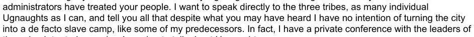
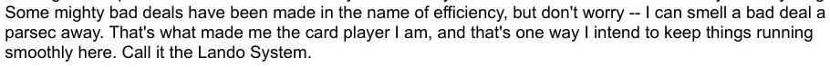

# Owner Material 037 — Star Wars D20 Drive folder (Core, Revised Core and Saga Edition): Locations/Planet Hoppers/Bespin - Action Tidings/Part 3 - The High Human o' Cloud City.pdf [Star Wars Roleplaying Game Revised Core (d20, 2002)]

- **Source:** Wizards of the Coast Star Wars Roleplaying Game books, web enhancements, Living Force campaign modules and articles (2000–2010), from the owner's "Star Wars D20" Drive folder (only the three edition subfolders; "General" was not read, as instructed). Secondary source (licensed Legends reference). Scan OCR'd on the box; the scan stays box-only and is **not** published.
- **Method:** every scanned page was OCR'd and machine-screened sentence by sentence for power-relevant statements (fights, kills, defeats, Force feats, rankings, superweapons) that name a character on our roster; each kept sentence is quoted verbatim from the OCR text and has a crop of the printed passage directly under it. Pages with nothing power-relevant are still listed with what is on them.
- **Citation:** "*Part 3 - The High Human o' Cloud City* (SWRPG d20 Revised Core), p.X" by printed page ("scan p.X" where no printed number applies). **Weight:** Licensed RPG material: a secondary source. Narrative text sums up Legends lore; game statistics are rules for players, not canon power levels, and rank lowest.

## scan p.1 (scan page 1)

Page contents: Lando won Cloud City at sabacc; Pordy kicks the holodisplay back on; archival interview opens ("Arse?") (hand-read)

## scan p.2 (scan page 2)

Page contents: Lando speaks to the three tribes; doubles Ugnaught wages; ends Tibanna refining on the Surface (hand-read)

- **No single roster character (rules/setting/general)** — entry/section: Lando Calrissian on Action Tidings: "I want to speak directly to the three tribes, as many individual Ugnaughts as I can, and tell you all that despite what you may have heard I have no intention of turning the city into a de facto slave camp, like some of my predecessors." Source: *Part 3 - The High Human o' Cloud City* (SWRPG d20 Revised Core), scan p.2
  

## scan p.3 (scan page 3)

Page contents: New city refineries; "the Lando System"; rumors (sabacc against Baron Raynor, Taanab, citizenship, Queen of Drogheda); GM notes on Ugnaughts under Calrissian; Ugnaught Foreman stats (Expert 10) (hand-read)

- **No single roster character (rules/setting/general)** — entry/section: Lando Calrissian on Action Tidings: "Some mighty bad deals have been made in the name of efficiency, but don't worry -- I can smell a bad deal a parsec away. That's what made me the card player I am, and that's one way I intend to keep things running smoothly here. Call it the Lando System." Source: *Part 3 - The High Human o' Cloud City* (SWRPG d20 Revised Core), scan p.3
  

### Stat block notes (game mechanics, not feats)

- Vader ended Lando's tenure on Cloud City: In the few short years that he ran Cloud City before Darth Vader changed his plans forever, Lando Calrissian proved to be the most capable, fair-minded baron-administrator in centuries. (Source: *Part 3 - The High Human o' Cloud City* (SWRPG d20 Revised Core), scan p.3)

## scan p.4 (scan page 4)

Page contents: Foreman feats; Part Four teaser (hand-read)

### Stat block notes (game mechanics, not feats)

- Vader takes over Cloud City (teaser): Lando makes a bad deal and Darth Vader takes over Cloud City just to show him. Action Tidings, as usual, is there! (Source: *Part 3 - The High Human o' Cloud City* (SWRPG d20 Revised Core), scan p.4)
