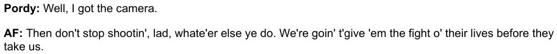
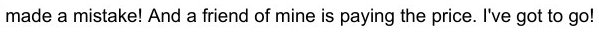

# Owner Material 037 — Star Wars D20 Drive folder (Core, Revised Core and Saga Edition): Locations/Planet Hoppers/Bespin - Action Tidings/Part 4 - The Empire's Ugly Nose.pdf [Star Wars Roleplaying Game Revised Core (d20, 2002)]

- **Source:** Wizards of the Coast Star Wars Roleplaying Game books, web enhancements, Living Force campaign modules and articles (2000–2010), from the owner's "Star Wars D20" Drive folder (only the three edition subfolders; "General" was not read, as instructed). Secondary source (licensed Legends reference). Scan OCR'd on the box; the scan stays box-only and is **not** published.
- **Method:** every scanned page was OCR'd and machine-screened sentence by sentence for power-relevant statements (fights, kills, defeats, Force feats, rankings, superweapons) that name a character on our roster; each kept sentence is quoted verbatim from the OCR text and has a crop of the printed passage directly under it. Pages with nothing power-relevant are still listed with what is on them.
- **Citation:** "*Part 4 - The Empire's Ugly Nose* (SWRPG d20 Revised Core), p.X" by printed page ("scan p.X" where no printed number applies). **Weight:** Licensed RPG material: a secondary source. Narrative text sums up Legends lore; game statistics are rules for players, not canon power levels, and rank lowest.

## scan p.1 (scan page 1)

Page contents: Fivvle and Pordy trapped in a utility closet as stormtroopers cut through the door (hand-read)

- **No single roster character (rules/setting/general)** — entry/section: Ars Fivvle to Pordy: "Then don't stop shootin', lad, whate'er else ye do. We're goin' t'give 'em the fight o' their lives before they take us." Source: *Part 4 - The Empire's Ugly Nose* (SWRPG d20 Revised Core), scan p.1
  

### Stat block notes (game mechanics, not feats)

- Vader's Cloud City deal: What Darth Vader wanted, Darth Vader almost always got. And after the destruction of the Death Star and the Battle of Hoth, he wanted more than anything to capture Luke Skywalker on Cloud City. Vader made Lando Calrissian a deal the latter literally could not refuse -- not if he wanted to see his city survive. (Source: *Part 4 - The Empire's Ugly Nose* (SWRPG d20 Revised Core), scan p.1)

## scan p.2 (scan page 2)

Page contents: Lando, Leia, and Chewbacca (carrying C-3PO) kill the troopers; Chewbacca's threat; Lando's "I made a mistake!"; Ugnaught rebels later drive out the Empire (hand-read)

- **No single roster character (rules/setting/general)** — entry/section: Lando Calrissian during the takeover: "I made a mistake! And a friend of mine is paying the price. I've got to go!" Source: *Part 4 - The Empire's Ugly Nose* (SWRPG d20 Revised Core), scan p.2
  

## scan p.3 (scan page 3)

Page contents: Zavlabar's ad; GM notes: Capt. Hugo Treece (Corellian, ex-Punisher) enslaved the Ugnaughts and embezzled; stats Noble 4/Soldier 1/Officer 7, CL E; Part Five teaser (Lando, Luke, Shira Brie); "The Fall of Cloud City" adventure plug (hand-read)

### Stat block notes (game mechanics, not feats)

- Vader appointed Treece; Lando exposed him to Vader: Imperial Navy Captain Hugo Treece, originally from Corellia, was personally appointed by Darth Vader to oversee Cloud City when the Empire seized control. (Source: *Part 4 - The Empire's Ugly Nose* (SWRPG d20 Revised Core), scan p.3)
- Treece's embezzlement sent to Vader: Shortly after Treece and his forces were driven off Bespin, Lando Calrissian arranged to send the details of Treece's embezzlement to Darth Vader's personal account on Aargau. Treece disappeared soon thereafter, presumed executed. (Source: *Part 4 - The Empire's Ugly Nose* (SWRPG d20 Revised Core), scan p.3)
