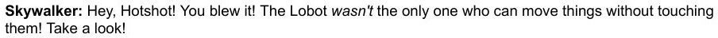
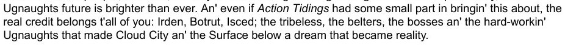
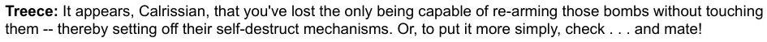
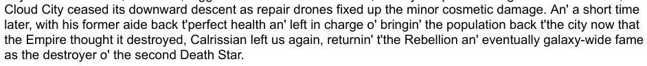

# Owner Material 037 — Star Wars D20 Drive folder (Core, Revised Core and Saga Edition): Locations/Planet Hoppers/Bespin - Action Tidings/Part 5 - An Exclusive!.pdf [Star Wars Roleplaying Game Revised Core (d20, 2002)]

- **Source:** Wizards of the Coast Star Wars Roleplaying Game books, web enhancements, Living Force campaign modules and articles (2000–2010), from the owner's "Star Wars D20" Drive folder (only the three edition subfolders; "General" was not read, as instructed). Secondary source (licensed Legends reference). Scan OCR'd on the box; the scan stays box-only and is **not** published.
- **Method:** every scanned page was OCR'd and machine-screened sentence by sentence for power-relevant statements (fights, kills, defeats, Force feats, rankings, superweapons) that name a character on our roster; each kept sentence is quoted verbatim from the OCR text and has a crop of the printed passage directly under it. Pages with nothing power-relevant are still listed with what is on them.
- **Citation:** "*Part 5 - An Exclusive!* (SWRPG d20 Revised Core), p.X" by printed page ("scan p.X" where no printed number applies). **Weight:** Licensed RPG material: a secondary source. Narrative text sums up Legends lore; game statistics are rules for players, not canon power levels, and rank lowest.

## scan p.1 (scan page 1)

Page contents: Treece's reign; Ugnaughts build a dozen bombs and warn everyone to evacuate; Lando returns and fights a damaged Lobot; talking bomb kills Treece's bomb squad; Treece kicks Lando off the city (hand-read)

## scan p.2 (scan page 2)

Page contents: Lobot catches Lando with a jet pack; Floatboat 2 rescue; Fivvle's film-can slingshot downs an Imperial skimmer; King Ozz briefs Lando; live footage: Luke, Shira Brie, and R2 vs Treece's troops (hand-read)

## scan p.3 (scan page 3)

Page contents: Treece shoots Lobot's implant; Luke triggers the primer charges with the Force; Imperials flee; city saved; Fivvle's closing tribute to the tribes (hand-read)

- **No single roster character (rules/setting/general)** — entry/section: Luke Skywalker to Treece (Marvel dialogue): "Hey, Hotshot! You blew it! The Lobot wasn't the only one who can move things without touching them! Take a look!" Source: *Part 5 - An Exclusive!* (SWRPG d20 Revised Core), scan p.3
  
- **No single roster character (rules/setting/general)** — entry/section: Ars Fivvle's closing: "the real credit belongs t'all of you: Irden, Botrut, Isced; the tribeless, the belters, the bosses an' the hard-workin' Ugnaughts that made Cloud City an' the Surface below a dream that became reality." Source: *Part 5 - An Exclusive!* (SWRPG d20 Revised Core), scan p.3
  
- **Lando Calrissian** — entry/section: Skywalker: (Off-camera) Well, I'll be! It's Lando!: "Treece: It appears, Calrissian, that you've lost the only being capable of re-arming those bombs without touching them -- thereby setting off their self-destruct mechanisms." Source: *Part 5 - An Exclusive!* (SWRPG d20 Revised Core), scan p.3
  
- **Lando Calrissian**: "An' a short time later, with his former aide back t'perfect health an' left in charge o' bringin' the population back t'the city now that the Empire thought it destroyed, Calrissian left us again, returnin' t'the Rebellion an' eventually galaxy-wide fame as the destroyer o' the second Death Star." Source: *Part 5 - An Exclusive!* (SWRPG d20 Revised Core), scan p.3
  

## scan p.4 (scan page 4)

Page contents: Sign-off; GM notes: talking bomb (droid brain, two Bluff checks at +20, Move Object DC 14 with Repair ranks; 8d12+20, 8,000 + 1d4 x 1,000 cr); Marvel #56-57 "Hello, Bespin, Good-bye!" sidebar (Shira Brie later revealed as an Imperial mole); next feature Dagobah (hand-read)

## scan p.5 (scan page 5)

Page contents: Living Force supplement plug (Jedi Master Darrius); copyright (hand-read)

