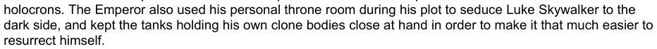

# Owner Material 037 — Star Wars D20 Drive folder (Core, Revised Core and Saga Edition): Locations/Planet Hoppers/Byss and the Deep Core/Part 1 - Byss.pdf [Star Wars Roleplaying Game Revised Core (d20, 2002)]

- **Source:** Wizards of the Coast Star Wars Roleplaying Game books, web enhancements, Living Force campaign modules and articles (2000–2010), from the owner's "Star Wars D20" Drive folder (only the three edition subfolders; "General" was not read, as instructed). Secondary source (licensed Legends reference). Scan OCR'd on the box; the scan stays box-only and is **not** published.
- **Method:** every scanned page was OCR'd and machine-screened sentence by sentence for power-relevant statements (fights, kills, defeats, Force feats, rankings, superweapons) that name a character on our roster; each kept sentence is quoted verbatim from the OCR text and has a crop of the printed passage directly under it. Pages with nothing power-relevant are still listed with what is on them.
- **Citation:** "*Part 1 - Byss* (SWRPG d20 Revised Core), p.X" by printed page ("scan p.X" where no printed number applies). **Weight:** Licensed RPG material: a secondary source. Narrative text sums up Legends lore; game statistics are rules for players, not canon power levels, and rank lowest.

## scan p.1 (scan page 1)

Page contents: Byss stats (Beshqek system, 19.7 billion, dark side theocracy); Palpatine's resort world corrupted by the dark side; Gauntlet Scanners and the Byss Security Zone; history (hand-read)

### Stat block notes (game mechanics, not feats)

- Palpatine corrupted Byss: Over time, the Emperor's dark side energies slowly corrupted the world and transformed it into one of the most powerful dark side sites in the entire galaxy. (Source: *Part 1 - Byss* (SWRPG d20 Revised Core), scan p.1)
- Palpatine drained the people of Byss: Once the populace had settled into their new lives in an Imperial utopia, the Emperor initiated his true plans for the world. Slowly but steadily, he used his dark Force powers to enslave the people on the world and drain their life energies to fuel his own vile experiments. (Source: *Part 1 - Byss* (SWRPG d20 Revised Core), scan p.1)

## scan p.2 (scan page 2)

Page contents: R2-D2 crashes the Eclipse II into the Galaxy Gun, Byss collapses; people dreamlike and censored; nobles cowed; Citadel (cloning, alchemy labs, holocrons, Adepts, Inquisitors); Gauntlet Scanner Stations (Golan III) (hand-read)

- **Luke Skywalker**: "The Emperor also used his personal throne room during his plot to seduce Luke Skywalker to the dark side, and kept the tanks holding his own clone bodies close at hand in order to make it that much easier to resurrect himself." Source: *Part 1 - Byss* (SWRPG d20 Revised Core), scan p.2
  

### Stat block notes (game mechanics, not feats)

- The reborn Emperor's buildup and defeat: Within months, the Emperor inhabited his clone body and began the rebuilding process. For years, Palpatine simply focused on building up his own power and preparing to strike at the New Republic. The shipyards of Byss worked day and night producing massive battlestations such as the Galaxy Gun and vast warships like the Eclipse-class and Sovereign-class Star Destroyers. (Source: *Part 1 - Byss* (SWRPG d20 Revised Core), scan p.2)
- Byss destroyed with the Galaxy Gun: Several deaths and reincarnations later, the Emperor and Byss were finally defeated. Using the planet-destroying weapon known as the Galaxy Gun, the Emperor struck out against the forces of the New Republic again and again. (Source: *Part 1 - Byss* (SWRPG d20 Revised Core), scan p.2)
- The Emperor's Citadel experiments: Deep within the citadel, the Emperor performs grisly experiments on all forms of life, including sentient beings, in order to expand his knowledge of the dark side; it was in the citadel that the Emperor crafted his Imperial Sovereign Protectors and the Chrysalide rancors. (Source: *Part 1 - Byss* (SWRPG d20 Revised Core), scan p.2)

## scan p.3 (scan page 3)

Page contents: Imperial Freight Complex; the Eclipse; Hunter-Killer Probot (Arakyd Viper-HK) stats; Shadow Droid introduced (Umak Leth design) (hand-read)

### Stat block notes (game mechanics, not feats)

- Palpatine willing to destroy his own stations: As has been proven before, the Emperor has no remorse about ordering the armada to blast a compromised station out of existence. (Source: *Part 1 - Byss* (SWRPG d20 Revised Core), scan p.3)

## scan p.4 (scan page 4)

Page contents: Shadow droids driven by alchemically twisted brains of dead TIE pilots; stats; adventures "Lost Among the Converted" and "Escape from New Order" (Cmdr. Varen Medis); Savuud Thimram profile and stats (Force Adept 5/Dark Side Devotee 7) (hand-read)

### Stat block notes (game mechanics, not feats)

- Palpatine took and twisted Thimram: The son of a wealthy noble family on Chandrila, Thimram was whisked away to Byss by the Emperor once he sensed the Force potential in the young man. Over the years, Palpatine warped his student with the powers and teachings of the dark side, and the end result is a loyal and sinister adept who acts on behalf of his dark master whenever called upon. (Source: *Part 1 - Byss* (SWRPG d20 Revised Core), scan p.4)

## scan p.5 (scan page 5)

Page contents: Thimram SQ from the image: Dark Side Talisman +2, Force weapon +1d8+1d4; Will +13, DSP 6; Force skills and feats; Dana "Deke" Galvason, Bakuran smuggler (Scoundrel 6, YT-2000 Bakuran Blade); Part Two teaser (Empress Teta) (hand-read)

