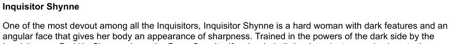

# Owner Material 037 — Star Wars D20 Drive folder (Core, Revised Core and Saga Edition): Locations/Planet Hoppers/Byss and the Deep Core/Part 3 - Prakith.pdf [Star Wars Roleplaying Game Revised Core (d20, 2002)]

- **Source:** Wizards of the Coast Star Wars Roleplaying Game books, web enhancements, Living Force campaign modules and articles (2000–2010), from the owner's "Star Wars D20" Drive folder (only the three edition subfolders; "General" was not read, as instructed). Secondary source (licensed Legends reference). Scan OCR'd on the box; the scan stays box-only and is **not** published.
- **Method:** every scanned page was OCR'd and machine-screened sentence by sentence for power-relevant statements (fights, kills, defeats, Force feats, rankings, superweapons) that name a character on our roster; each kept sentence is quoted verbatim from the OCR text and has a crop of the printed passage directly under it. Pages with nothing power-relevant are still listed with what is on them.
- **Citation:** "*Part 3 - Prakith* (SWRPG d20 Revised Core), p.X" by printed page ("scan p.X" where no printed number applies). **Weight:** Licensed RPG material: a secondary source. Narrative text sums up Legends lore; game statistics are rules for players, not canon power levels, and rank lowest.

## scan p.1 (scan page 1)

Page contents: Prakith stats (fortress world, mountains and plateaus, dictatorship); volcanic history; Imperial colonization; the Emperor makes it the Inquisitorius home office (hand-read)

### Stat block notes (game mechanics, not feats)

- Emperor based the Inquisitorius on Prakith: More than just a fortress world, however, the Emperor also selected Prakith to be the home office of the Inquisitorius in the Deep Core region. With the dark power of the Inquisitors tainting the world and the heavy fortifications put in place by the Empire, Prakith became a foreboding planet where all treaded lightly. (Source: *Part 3 - Prakith* (SWRPG d20 Revised Core), scan p.1)

## scan p.2 (scan page 2)

Page contents: Moff Foga Brill backs the reborn Emperor, then becomes a warlord; cowed people; Mining Guild; Asonel cave system; Citadel Inquisitorius (screams of captured Jedi); Prak City (hand-read)

## scan p.3 (scan page 3)

Page contents: Hooks "Behind Enemy Lines" and "Jedi Business"; Inquisitor Shynne (Jedi Consular 6/Imperial Inquisitor 6, built her own lightsaber); Andren Biel, Rebel spy (Noble 2/Scoundrel 4) (hand-read)

- **Inquisitor Shynne** — entry/section: Part 3 - Prakith: "Inquisitor Shynne One of the most devout among all the Inquisitors, Inquisitor Shynne is a hard woman with dark features and an angular face that gives her body an appearance of sharpness." Source: *Part 3 - Prakith* (SWRPG d20 Revised Core), scan p.3
  

### Stat block notes (game mechanics, not feats)

- Inquisitor Shynne: Female Human Jedi Consular 6/Imperial Inquisitor 6; Init +3 (+3 Dex); Defense 22 (+3 Dex, +9 Class); Spd 10 m; VP/WP 79/12; Atk +14/+9 melee* (4d8+1, crit 19-20, lightsaber) or +10/+5 melee (1d3+1, punch) or +12/+7 ranged (by weapon); SQ Authority, Deflect (Attack -4, Defense +3, Extend Defense and Attack), Favored Enemy +2 (Jedi Guardian), Increase Lightsaber damage +2d8, Reso (Source: *Part 3 - Prakith* (SWRPG d20 Revised Core), scan p.3)

## scan p.4 (scan page 4)

Page contents: Cliff hawk (from the image): Mountain Predator 3; Init +2; Def 14; Spd 20 m fly/5 m walk; VP/WP -/5; claw 1d3+1, bite 1d4+1; SZ T. Other locales: Ebaq 9 (Yuuzhan Vong trap), Eclipse base, Khomm (cloning society), Tsoss Beacon (hand-read)

## scan p.5 (scan page 5)

Page contents: Part Four teaser (Vulpter); copyright (hand-read)

