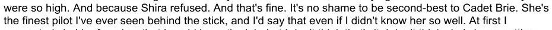

# Owner Material 037 — Star Wars D20 Drive folder (Core, Revised Core and Saga Edition): Locations/Planet Hoppers/Carida - Heavy Duty/Part 1 - Weight Training.pdf [Star Wars Roleplaying Game Revised Core (d20, 2002)]

- **Source:** Wizards of the Coast Star Wars Roleplaying Game books, web enhancements, Living Force campaign modules and articles (2000–2010), from the owner's "Star Wars D20" Drive folder (only the three edition subfolders; "General" was not read, as instructed). Secondary source (licensed Legends reference). Scan OCR'd on the box; the scan stays box-only and is **not** published.
- **Method:** every scanned page was OCR'd and machine-screened sentence by sentence for power-relevant statements (fights, kills, defeats, Force feats, rankings, superweapons) that name a character on our roster; each kept sentence is quoted verbatim from the OCR text and has a crop of the printed passage directly under it. Pages with nothing power-relevant are still listed with what is on them.
- **Citation:** "*Part 1 - Weight Training* (SWRPG d20 Revised Core), p.X" by printed page ("scan p.X" where no printed number applies). **Weight:** Licensed RPG material: a secondary source. Narrative text sums up Legends lore; game statistics are rules for players, not canon power levels, and rank lowest.

## scan p.1 (scan page 1)

Page contents: Carida, later destroyed by a superweapon in the hands of a disturbed Jedi apprentice; Republic Defense Academy founded two centuries before Palpatine, taken over by the Empire; planet stats (1.98 g); Carida as the "stormtrooper factory"; Davani's transcript intro (hand-read)

## scan p.2 (scan page 2)

Page contents: Davani's letter: piloted the class shuttle, defers to Cadet Shira Brie, describes Carida, the gravity, and the curriculum; Part Two teaser; "Jedi Counseling" plug (hand-read)

- **No single roster character (rules/setting/general)** — entry/section: Cadet Myrette Davani's letter: "It's no shame to be second-best to Cadet Brie. She's the finest pilot I've ever seen behind the stick, and I'd say that even if I didn't know her so well." Source: *Part 1 - Weight Training* (SWRPG d20 Revised Core), scan p.2
  
- **No single roster character (rules/setting/general)** — entry/section: Cadet Myrette Davani's letter: "Personally, I reckon survival's going to be part of every course." Source: *Part 1 - Weight Training* (SWRPG d20 Revised Core), scan p.2
  
