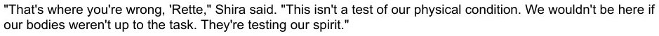

# Owner Material 037 — Star Wars D20 Drive folder (Core, Revised Core and Saga Edition): Locations/Planet Hoppers/Carida - Heavy Duty/Part 2 - Boot Camp.pdf [Star Wars Roleplaying Game Revised Core (d20, 2002)]

- **Source:** Wizards of the Coast Star Wars Roleplaying Game books, web enhancements, Living Force campaign modules and articles (2000–2010), from the owner's "Star Wars D20" Drive folder (only the three edition subfolders; "General" was not read, as instructed). Secondary source (licensed Legends reference). Scan OCR'd on the box; the scan stays box-only and is **not** published.
- **Method:** every scanned page was OCR'd and machine-screened sentence by sentence for power-relevant statements (fights, kills, defeats, Force feats, rankings, superweapons) that name a character on our roster; each kept sentence is quoted verbatim from the OCR text and has a crop of the printed passage directly under it. Pages with nothing power-relevant are still listed with what is on them.
- **Citation:** "*Part 2 - Boot Camp* (SWRPG d20 Revised Core), p.X" by printed page ("scan p.X" where no printed number applies). **Weight:** Licensed RPG material: a secondary source. Narrative text sums up Legends lore; game statistics are rules for players, not canon power levels, and rank lowest.

## scan p.1 (scan page 1)

Page contents: Brie's file comes from Luke's investigation after he was falsely accused of murdering "Vader's operative"; Davani letter "What a Planet": boot camp with stormtrooper cadets; Shira explains the weight test and the lowered Academy gravity (hand-read)

- **No single roster character (rules/setting/general)** — entry/section: Shira Brie to Davani: "That's where you're wrong, 'Rette. This isn't a test of our physical condition. We wouldn't be here if our bodies weren't up to the task. They're testing our spirit." Source: *Part 2 - Boot Camp* (SWRPG d20 Revised Core), scan p.1
  

### Stat block notes (game mechanics, not feats)

- Vader protected Shira Brie's cover: This file is extensive, considering the lengths to which Darth Vader himself went to ensure that no one discovered Brie's identity while she was undercover. (Source: *Part 2 - Boot Camp* (SWRPG d20 Revised Core), scan p.1)

## scan p.2 (scan page 2)

Page contents: Twenty of two hundred finish the hike; Part Three teaser (Mountain Terrain Scout Transport war games); "Hutt! Hutt! Hutt!" plug (hand-read)

