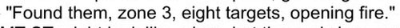

# Owner Material 037 — Star Wars D20 Drive folder (Core, Revised Core and Saga Edition): Locations/Planet Hoppers/Carida - Heavy Duty/Part 3 - War Games.pdf [Star Wars Roleplaying Game Revised Core (d20, 2002)]

- **Source:** Wizards of the Coast Star Wars Roleplaying Game books, web enhancements, Living Force campaign modules and articles (2000–2010), from the owner's "Star Wars D20" Drive folder (only the three edition subfolders; "General" was not read, as instructed). Secondary source (licensed Legends reference). Scan OCR'd on the box; the scan stays box-only and is **not** published.
- **Method:** every scanned page was OCR'd and machine-screened sentence by sentence for power-relevant statements (fights, kills, defeats, Force feats, rankings, superweapons) that name a character on our roster; each kept sentence is quoted verbatim from the OCR text and has a crop of the printed passage directly under it. Pages with nothing power-relevant are still listed with what is on them.
- **Citation:** "*Part 3 - War Games* (SWRPG d20 Revised Core), p.X" by printed page ("scan p.X" where no printed number applies). **Weight:** Licensed RPG material: a secondary source. Narrative text sums up Legends lore; game statistics are rules for players, not canon power levels, and rank lowest.

## scan p.1 (scan page 1)

Page contents: War games in Tarkin's Teeth with MT-ST "bug walkers"; Shira's walker was fully armed; she killed half a dozen cadets and was laughing; written off as "instructor error" (hand-read)

- **No single roster character (rules/setting/general)** — entry/section: Shira Brie's transmission: "Found them, zone 3, eight targets, opening fire." Source: *Part 3 - War Games* (SWRPG d20 Revised Core), scan p.1
  
- **No single roster character (rules/setting/general)** — entry/section: Cadet Myrette Davani's letter: "If I hadn't seen it with my own eyes, I'd be willing to let it go. But I think my friend Shira's got a darkness in her, and I'm going to keep a closer eye on her." Source: *Part 3 - War Games* (SWRPG d20 Revised Core), scan p.1
  

### Stat block notes (game mechanics, not feats)

- Vader's personal instruction of Shira Brie: An incident midway through Davani's year of study on Carida provides a telling look into Imperial training techniques, and the effects that Darth Vader's personal instruction was beginning to have on cadet Shira Brie's psyche. (Source: *Part 3 - War Games* (SWRPG d20 Revised Core), scan p.1)

## scan p.2 (scan page 2)

Page contents: MT-ST "Bug Walker" stats (Huge, 40 m, twin blaster cannon 4d10); Part Four teaser; "With the Band" plug (hand-read)

