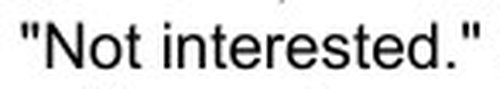

# Owner Material 037 — Star Wars D20 Drive folder (Core, Revised Core and Saga Edition): Locations/Planet Hoppers/Carida - Heavy Duty/Part 4 - Cadets Gone Wild.pdf [Star Wars Roleplaying Game Revised Core (d20, 2002)]

- **Source:** Wizards of the Coast Star Wars Roleplaying Game books, web enhancements, Living Force campaign modules and articles (2000–2010), from the owner's "Star Wars D20" Drive folder (only the three edition subfolders; "General" was not read, as instructed). Secondary source (licensed Legends reference). Scan OCR'd on the box; the scan stays box-only and is **not** published.
- **Method:** every scanned page was OCR'd and machine-screened sentence by sentence for power-relevant statements (fights, kills, defeats, Force feats, rankings, superweapons) that name a character on our roster; each kept sentence is quoted verbatim from the OCR text and has a crop of the printed passage directly under it. Pages with nothing power-relevant are still listed with what is on them.
- **Citation:** "*Part 4 - Cadets Gone Wild* (SWRPG d20 Revised Core), p.X" by printed page ("scan p.X" where no printed number applies). **Weight:** Licensed RPG material: a secondary source. Narrative text sums up Legends lore; game statistics are rules for players, not canon power levels, and rank lowest.

## scan p.1 (scan page 1)

Page contents: Davani's "Ladies' Night Out" letter: Shira's secret nightly private tutoring; Caridan merchants; a cantina crawl; Shira drops a Caridan with a look and a wave (hand-read)

- **No single roster character (rules/setting/general)** — entry/section: Shira Brie to a Caridan: "Not interested." Source: *Part 4 - Cadets Gone Wild* (SWRPG d20 Revised Core), scan p.1
  
- **No single roster character (rules/setting/general)** — entry/section: Cadet Myrette Davani's letter: "Maybe she's not the same person after all." Source: *Part 4 - Cadets Gone Wild* (SWRPG d20 Revised Core), scan p.1
  

## scan p.2 (scan page 2)

Page contents: Caridan species (Str +6, Dex -6, +4 Appraise, +2 Fort); Caridan Commoner stats; October teaser (Korriban); "Tips and Tactics" plug (hand-read)

